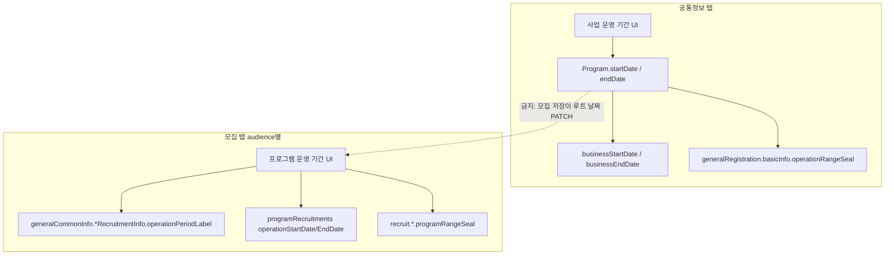

# 일반 프로그램 — 사업 운영 기간 vs 모집별 프로그램 운영 기간 (CMS FE 구현 가이드)

**대상:** JaKorea CMS `apps/cms/` — 일반(GENERAL) 프로그램 등록·상세 수정  
**목적:** 다른 FE 개발자(또는 Cursor Agent)가 **이 문서만** 읽고 요구사항을 완전히 구현할 수 있도록 SSOT·현재 결함·수정 절차·검증을 정리한다.  
**백엔드:** OpenAPI v9 기준 **신규 API 필드 불필요**. 기존 `businessStartDate`/`businessEndDate`, `recruitments[].operationStartDate`/`operationEndDate`, `serviceDetailJson` nested·`registrationOverlay`를 올바르게 쓰면 된다.

**관련 process rule:** `apps/cms/.cursor/rules/process/program-detail-overlay-save-ssot.mdc`  
**도메인 SSOT 코멘트:** `apps/cms/src/features/program/shared/lib/program-business-period.ts`

---

## 1. 제품 요구사항 (반드시 충족)

| # | 요구 | 실패 시 사용자 관점 |
|---|------|---------------------|
| R1 | **사업 운영 기간**(공통정보)과 **프로그램 운영 기간**(모집 양식·모집 탭)은 **다른 개념**이다. 서로 같아야 한다는 제약 없음. | 공통정보에서 사업 기간을 바꿨는데 모집「프로그램 운영 기간」이 같이 바뀌거나, 반대로 모집 저장이 사업 기간을 덮어씀 |
| R2 | **등록(위저드)** 과 **상세 수정** 모두 R1을 만족해야 한다. | 등록만 맞고 상세에서 깨지거나 그 반대 |
| R3 | **모집 탭(또는 모집 양식)별**로 프로그램 운영 기간을 **독립 설정** 가능. 예: 강사 모집 ≠ 봉사자 모집. | 한 탭에서 바꾸면 다른 탭·사업 기간까지 동기화됨 |
| R4 | 모집 탭 저장은 **현재 편집 중인 audience만** 프로그램 운영 기간·관련 nested·overlay·recruitment 행을 갱신한다. 다른 audience·사업 기간은 **유지**. | 참여자 탭 저장이 강사 `operationPeriodLabel`까지 덮어씀 |

**용어 (UI 라벨)**

| UI 라벨 | 의미 | 저장 SSOT (수정 후) |
|---------|------|---------------------|
| 사업 운영 기간 | 프로그램 사업 전체 기간 | API `businessStartDate` / `businessEndDate` ↔ 도메인 `Program.startDate` / `endDate` (사업만) |
| 프로그램 운영 기간 | 해당 모집 유형 안내용 운영 기간 | `recruitments[]`의 `operationStartDate` / `operationEndDate` + nested `*RecruitmentInfo.operationPeriodLabel` + overlay `recruit.*.programRangeSeal` |
| 모집 기간 | 신청 접수 창 | `applicationStartDate`/`EndDate`, 강사·봉사자는 `instructorApplication*` / `volunteerApplication*` + `recruitRangeSeal` |

---

## 2. 현재 결함 요약 (왜 안 맞는지)

### 2.1 상세 모집 UI·폼

- 참여자 / 강사 / 봉사자 모집 화면 모두 **「프로그램 운영 기간」**이 RHF **`name="startDate"` / `name="endDate"`** 에 연결됨.
- 공통정보 **「사업 운영 기간」**도 동일 필드명 `startDate` / `endDate` 사용 (`common-info-view.tsx`).
- 도메인에서 `Program.startDate`/`endDate`는 **사업 운영** SSOT (`program-business-period.ts`)인데, 모집 탭이 같은 필드를 쓰면 **개념이 합쳐진다**.

**파일**

- `apps/cms/src/features/program/general/ui/detail-modal/info/participant-recruitment-info-view.tsx`
- `apps/cms/src/features/program/general/ui/detail-modal/info/instructor-recruitment-info-view.tsx`
- `apps/cms/src/features/program/general/ui/detail-modal/info/volunteer-recruitment-info-view.tsx`

### 2.2 저장 PATCH (`detailEditValuesToProgramPatch`)

- 모집 탭 저장도 `detailEditValuesToProgramPatch`를 타며 **항상** 루트 `startDate`/`endDate`를 PATCH에 포함.
- 동시에 `participantRecruitmentInfo`, `instructorRecruitmentInfo`, `volunteerRecruitmentInfo`의 **`operationPeriodLabel`을 모두 같은 `startDate`/`endDate`로** 계산 (`program-detail-edit-schema.ts` ~1105, ~1491, ~1527).

### 2.3 API 어댑터

- `mapProgramCoreFieldsToRequest` / 부분 PATCH에서 `startDate`·`endDate`와 **`businessStartDate`·`businessEndDate`를 동일한 `program.startDate`/`endDate`로 동시 전송** (`general-program-adapters.ts` ~750, ~923–927).
- `mapGeneralProgramRecruitmentsToRequest`는 모집 창만 `startAt`/`endAt`으로 보내고 **`operationStartDate`/`operationEndDate`를 일반 프로그램 경로에서 설정하지 않음** (UJAT 어댑터는 설정하는 참고 패턴: `ujat/api/adapters.ts` `recruitmentRow`).

### 2.4 Overlay resync

- `buildGeneralRecruitOverlayFromProgram`이 `participantProgram`을 `program.startDate`/`endDate`(+ 참여자 라벨)에서 만들고, **강사·봉사자 `programRangeSeal`에도 동일 `participantProgram`을 복사** (`general-recruit-overlay-from-program.ts` ~301–308).
- `resyncGeneralRecruitOverlayFromProgram` = `{ ...editOverlay, ...buildGeneralRecruitOverlayFromProgram(program) }` → **폼에서 audience별로 넣은 seal이 resync 시 참여자/사업 기간으로 덮일 수 있음**.

### 2.5 시드·표시 (`resolveGeneralProgramForRecruitmentEdit`)

- `enrichParticipantRecruitmentScalars` / `enrichInstructorRecruitmentScalars` / `enrichVolunteerRecruitmentScalars`가 각각 **`program.startDate`/`endDate`를 해당 audience의 `operationPeriodLabel`로 coalesce** (`general-program-recruitment-edit-seed.ts`).
- 체인 마지막(봉사자)이 루트 `startDate`를 이길 수 있어, **모든 모집 탭이 같은 날짜 한 쌍**으로 보이기 쉬움.

### 2.6 등록 위저드 (상대적으로 양호)

- 사업: `generalRegistration.basicInfo.operationRangeSeal` → `applyGeneralRegistrationOverlayToProgram` → `program.startDate`/`endDate` (`registration-overlay-to-program.ts`).
- 모집: audience별 `recruit.individual|instructor|volunteer.programRangeSeal` (`registration-recruitment-required-fields.ts`, recruit form paragraphs).
- `applyGeneralRecruitOverlayToProgram`은 `programRangeSeal`이 **루트 `startDate`/`endDate`를 덮지 않음** (테스트: `general-recruit-overlay-to-program.test.ts` 「모집 사업 운영 기간은 공통정보 startDate/endDate를 덮지 않는다」).

**등록 후 상세 편집·저장**이 2.1–2.5 때문에 요구사항을 깨는 주 경로다.

---

## 3. 목표 아키텍처 (수정 후 SSOT)

**핵심 규칙**

1. **공통정보 저장:** `startDate`/`endDate`(사업) + `operationRangeSeal`만 갱신. 모집 nested·`recruitments` 운영 필드는 PATCH에 넣지 않음 (기존 `narrowProgramDetailPatchForCommonInfoSave` 유지·확장 검토).
2. **모집 탭 저장:** audience별 프로그램 운영 날짜만 nested·overlay·해당 recruitment 행의 `operationStartDate`/`operationEndDate` 갱신. **루트 `startDate`/`endDate`·`businessStartDate`/`businessEndDate`는 PATCH에 포함하지 않음.**
3. **읽기:** 모집 탭 시드는 **해당 audience**의 `operationPeriodLabel` 또는 `programRecruitments` 행의 `operationStartDate`/`operationEndDate`(종료일은 API `operationEndDate` — 아래 4.2) 우선. **사업 `startDate`로 모집 폼을 채우지 않음** (fallback 정책은 5.3).

---

## 4. 백엔드 API (수정 불필요 — FE가 채워야 할 필드)

OpenAPI: `apps/cms/src/shared/api/generated/posts/schemas/programUpdateRequest.ts`, `programRecruitmentRequest.ts`

| 필드 | 용도 |
|------|------|
| `businessStartDate`, `businessEndDate` | 사업 운영 기간 |
| `startDate`, `endDate` (루트) | BE/레거시와 혼용 가능 — **모집 저장 시 보내지 말 것**. 공통정보·전체 create 시 사업과 동일하게 보내는 기존 create 경로는 사업 SSOT 유지 |
| `recruitments[].startAt`, `endAt` | 모집 **신청** 기간 |
| `recruitments[].operationStartDate`, `operationEndDate` | 해당 유형 **프로그램 운영** 기간 |
| `serviceDetailJson` | `generalCommonInfo`, `registrationOverlay` 등 JSON 문자열 |

**BE 동작 (OpenAPI 주석)**

- recruitment `operationStartDate`/`operationEndDate`: 수정 시 **미전송하면 기존 값 보존**, 최초 생성 시 사업 시작/종료 fallback.
- 모집정보 수정 잠금: 유형별 `operationStartDate` (`program-edit-window.ts`, `common-info-edit-policy.ts`).

**참고 구현 (다른 프로그램 유형):** `apps/cms/src/features/program/ujat/api/adapters.ts` — `recruitmentRow`에 `operationStartDate`/`operationEndDate` 포함.

---

## 5. 구현 절차 (권장 순서)

### 5.1 RHF 폼 필드 분리 (필수)

**공통정보:** 기존 `startDate` / `endDate` = **사업 운영만** (변경 없음).

**모집 탭:** audience별 전용 필드 추가 (이름은 팀 컨벤션에 맞게 통일; 아래는 권장안).

| audience | 권장 필드명 | 용도 |
|----------|-------------|------|
| participant | `participantProgramOperationStartDate`, `participantProgramOperationEndDate` | 참여자(기관·개인) 모집 「프로그램 운영 기간」 |
| instructor | `instructorProgramOperationStartDate`, `instructorProgramOperationEndDate` | 강사 모집 |
| volunteer | `volunteerProgramOperationStartDate`, `volunteerProgramOperationEndDate` | 봉사자 모집 |

**수정 파일**

1. `apps/cms/src/features/program/shared/model/program-detail-edit-schema.ts`
   - `programDetailEditSchemaBase`에 위 6개 필드 추가 (`optionalString` 패턴).
   - `programToDetailEditValues`: 사업용 `startDate`/`endDate`는 기존 유지; 모집 전용 필드는 **초기값 비우거나 공통정보에서만 사업 매핑**.
   - `programToRecruitmentTabEditValues` (`general-program-recruitment-edit-seed.ts`)에서 audience별 시드 (5.3).
   - `detailEditValuesToProgramPatch`: **옵션 A(권장)** — 시그니처에 `recruitmentAudience?: 'participant'|'instructor'|'volunteer'` 추가하고, 모집 저장 시 호출부에서 전달. audience가 있으면:
     - 루트 `startDate`/`endDate` **PATCH 객체에서 제외** (또는 `existing` 유지).
     - `operationPeriodLabel`은 **해당 audience nested만** audience 전용 필드로 `periodLabelFromRange` 계산.
     - 다른 audience nested의 `operationPeriodLabel`은 `existing` 유지 (spread 시 덮어쓰지 않기).
   - **옵션 B** — `use-program-detail-info-save.ts`에서 `recruitmentAudience`일 때 `detailEditValuesToProgramPatch` 결과에서 `startDate`/`endDate` 삭제 + `generalCommonInfo`에서 다른 audience recruitment 블록을 existing으로 재병합. (옵션 A가 단일 SSOT에 유리)

2. `apps/cms/src/features/program/general/lib/program-recruitment-save-fields.ts`
   - `startDate`/`endDate` 제거 또는 audience 전용 필드로 교체.
   - `programTrainedTeachersRecruitmentSaveSchema`의 required도 participant 전용 필드명으로 변경.

3. 모집 UI 3종 — `ParagraphDatePicker` `Controller` `name`을 audience 전용 필드로 변경:
   - `participant-recruitment-info-view.tsx`
   - `instructor-recruitment-info-view.tsx`
   - `volunteer-recruitment-info-view.tsx`

4. `apps/cms/src/features/program/general/lib/detail-recruitment-required-highlight.ts`
   - `programRangeSeal` 하이라이트가 audience별 전용 필드를 보도록 수정 (~81, ~104, ~130).

### 5.2 Overlay patch (`detail-operational-save-merge.ts`)

- `participantRecruitOverlayPatchFromDetailEditValues`: `rangeSealFromDates(values.startDate, values.endDate)` → **`participantProgramOperationStartDate`/`EndDate`**.
- `instructorRecruitOverlayPatchFromDetailEditValues`: **`instructorProgramOperation*`**.
- `volunteerRecruitOverlayPatchFromDetailEditValues`: volunteer targets 외에 program range가 있으면 **`volunteerProgramOperation*`** (현재 volunteer overlay patch는 targets만 있는 파일이 두 곳에 있음 — `detail-operational-save-merge.ts` 내 volunteer 함수와 `general-recruit-overlay-from-program.ts`의 stub; **merge 파일의 volunteer patch가 저장에 쓰이는 SSOT**).

### 5.3 시드 (`general-program-recruitment-edit-seed.ts`)

**`programToRecruitmentTabEditValues(program, audience)`** 에 audience별 프로그램 운영 ISO 날짜 채우기:

**우선순위 (각 audience)**

1. `program.programRecruitments`에서 `recruitmentType`이 PARTICIPANT / INSTRUCTOR / VOLUNTEER인 행의 `operationStartDate` (+ 종료: API `operationEndDate` — 5.4에서 도메인 타입·매핑 추가 후 사용).
2. `generalCommonInfo.{participant|instructor|volunteer}RecruitmentInfo.operationPeriodLabel` → `parseDisplayPeriodLabelToIsoRange` (이미 export됨).
3. `registrationOverlay`의 `recruit.{individual|instructor|volunteer}.programRangeSeal` (`applyGeneralRecruitOverlayToProgram` 후 읽기).
4. **금지:** 사업 `program.startDate`/`endDate`를 모집 「프로그램 운영」 기본값으로 쓰기.

**`enrich*RecruitmentScalars`:** `startDate`/`endDate` coalesce **제거** (participant/instructor/volunteer 모두). 이 함수들은 모집 **신청** 기간·타깃 등만 enrich하고, 루트 사업 날짜는 건드리지 않음.

### 5.4 `buildGeneralRecruitOverlayFromProgram` / resync

파일: `apps/cms/src/features/program/general/lib/general-recruit-overlay-from-program.ts`

- `participantProgram` range: 참여자 nested `operationPeriodLabel` 또는 참여자 recruitment 행 operation 날짜. **`program.startDate`/`endDate`만으로 만들지 말 것** (사업 기간과 분리).
- **강사 `keys.instructor.programRangeSeal`:** `instructorRecruitmentInfo.operationPeriodLabel` 또는 INSTRUCTOR 행 `operationStartDate`/`operationEndDate`에서 생성.
- **봉사자:** 동일하게 volunteer 소스만.
- `if (participantProgram) overlay[keys.instructor.programRangeSeal] = participantProgram` 같은 **cross-audience 복사 삭제**.

`resyncGeneralRecruitOverlayFromProgram` 동작은 유지하되, 위 함수가 audience별로 맞게 채우면 폼 patch + resync가 일관됨.

### 5.5 API 어댑터 (`general-program-adapters.ts`)

1. **`mapGeneralProgramRecruitmentsToRequest`**
   - 각 행에 audience별 프로그램 운영 ISO를 `operationStartDate` / `operationEndDate`로 설정.
   - 날짜 소스: `program`의 nested `operationPeriodLabel` 파싱 또는 (권장) 도메인에 `programRecruitments`에 이미 반영된 operation 날짜.
   - 참고: `toRequestDate` / `dateValue` 패턴 (`ujat/api/adapters.ts`).

2. **부분 PATCH `mapProgramPatchFieldsToRequest`**
   - `has('startDate') || has('endDate')` 블록: **모집 전용 patch에서는 이 키가 없어야 함** (5.1).
   - 모집 저장 시 `recruitments`에 operation 날짜 포함하려면:
     - patch에 audience별 operation 필드 플래그 추가하거나,
     - `has('programRecruitments')` / nested `generalCommonInfo` 변경 시 해당 audience 행만 `operationStartDate`/`operationEndDate` 업데이트하는 헬퍼 추가.
   - **잠금:** `isProgramOperationStartLocked` — operation 날짜만 잠그는 유형은 PATCH에서 제외 (기존 application window 잠금 패턴 ~929–971 확장).

3. **`toProgramRecruitmentWindows`** (`program-edit-window.ts`)
   - API `operationEndDate`를 도메인 `ProgramRecruitmentWindow`에 매핑 추가 (타입 `domain.ts`에 `operationEndDate?: string | null` 추가).

### 5.6 저장 훅 (`use-program-detail-info-save.ts`)

- `recruitmentAudience` 분기에서 `detailEditValuesToProgramPatch(values, program, { recruitmentAudience })` 호출.
- 저장 후 `buildMergedRegistrationOverlayForRecruitSave` + `resyncGeneralRecruitOverlayFromProgram` 유지 (`program-detail-overlay-save-ssot.mdc`).
- 공통정보 저장: `narrowProgramDetailPatchForCommonInfoSave` — 모집 nested 제거는 기존과 동일.

### 5.7 등록 위저드 (검증·소폭 수정)

- 모집 양식 paragraph는 이미 audience별 `recruit.*.programRangeSeal` 사용 (`recruit-form-instructor-info-paragraph.tsx` 등).
- 등록 완료 POST 시 `applyGeneralRegistrationOverlayToProgram` + recruit overlay apply 순서가 사업·모집을 분리하는지 **회귀 테스트** 추가 권장.
- dev autofill이 세 audience에 동일 seal을 넣는 것은 개발 편의 (`apply-dev-program-registration-autofill.ts`) — 제품 요구와 무관.

### 5.8 교받교·1사1교·UJAT

- 이 문서 **1차 범위는 GENERAL 일반 프로그램 상세·등록**.
- UJAT는 이미 `operationStartDate`/`operationEndDate` 전송 패턴 있음 — **일반 프로그램만 UJAT 패턴으로 align**.
- trained-teachers `programTrainedTeachersRecruitmentSaveSchema`의 `startDate`/`endDate` required → participant 전용 필드로 이전.

---

## 6. 파일 체크리스트

| 파일 | 작업 |
|------|------|
| `program-detail-edit-schema.ts` | 필드·시드·PATCH audience 분기 |
| `program-recruitment-save-fields.ts` | Zod save schema |
| `participant/instructor/volunteer-recruitment-info-view.tsx` | Controller name |
| `detail-operational-save-merge.ts` | overlay rangeSeal 소스 |
| `general-recruit-overlay-from-program.ts` | audience별 programRangeSeal, cross-copy 제거 |
| `general-program-recruitment-edit-seed.ts` | 시드·enrich coalesce 제거 |
| `general-program-adapters.ts` | recruitments operation 날짜, PATCH 분리 |
| `program-edit-window.ts` | operationEndDate 매핑 |
| `types/domain.ts` | `ProgramRecruitmentWindow.operationEndDate` |
| `detail-recruitment-required-highlight.ts` | 필수 하이라이트 키 |
| `use-program-detail-info-save.ts` | PATCH audience 전달 |
| `general-recruit-overlay-to-program.test.ts` | 회귀 유지 |
| `detail-operational-save-merge.test.ts` | audience별 seal |
| `general-program-recruitment-edit-seed.test.ts` | 시드·파싱 |
| `general-program-adapters.test.ts` | operation 날짜 전송 |
| `program-detail-edit-schema.test.ts` | PATCH가 사업 날짜 안 건드림 |
| `use-program-detail-info-save.volunteer.test.ts` | overlay resync |

---

## 7. 테스트 시나리오 (자동화)

1. **Overlay apply:** 기존 `general-recruit-overlay-to-program.test.ts` — participant `programRangeSeal`이 루트 `startDate` 변경하지 않음 (유지).

2. **모집 PATCH 분리:** `detailEditValuesToProgramPatch` with `recruitmentAudience: 'instructor'` — `startDate`/`endDate` absent, `instructorRecruitmentInfo.operationPeriodLabel`만 갱신, `participantRecruitmentInfo.operationPeriodLabel`은 existing 동일.

3. **Adapter:** program에 사업 `startDate` A, instructor operation B — `mapGeneralProgramRecruitmentsToRequest` INSTRUCTOR 행에 B의 operation 날짜, `businessStartDate`는 A (공통정보 patch 시만).

4. **Resync:** instructor overlay patch만 merged — `resyncGeneralRecruitOverlayFromProgram` 후 `recruit.instructor.programRangeSeal` ≠ `recruit.volunteer.programRangeSeal` 가능.

5. **Seed:** `programToRecruitmentTabEditValues(p, 'volunteer')` — volunteer nested 라벨과 다른 instructor 라벨이 각각 volunteer/instructor 폼 필드에 반영.

---

## 8. 수동 QA 체크리스트

1. 프로그램 등록: 사업 기간 1/1–12/31, 강사 프로그램 운영 3/1–3/31, 봉사자 4/1–4/30 → 저장 후 상세 각 모집 탭에 **서로 다른** 프로그램 운영 기간 표시.
2. 상세 공통정보: 사업 기간만 변경 → 모집 탭 프로그램 운영 기간 **변경 없음**.
3. 강사 모집 탭만 프로그램 운영 변경 → 참여자·봉사자·사업 기간 **변경 없음**.
4. GET 재진입 후 값 유지 (F5, 모달 닫기 후 재오픈).
5. 모집정보 수정 잠금: 해당 유형 `operationStartDate` 당일 이후 필드 disabled (`common-info-edit-policy` / 화면 동작).
6. 목록·캘린더: 사업 기간은 `program.startDate`/`business*` 기준 유지 (`program-calendar-events.ts` 「사업 운영 시작/종료」).

---

## 9. 하지 말 것 (회귀 방지)

- 모집 저장 PATCH에 **루트 `startDate`/`endDate` 포함** (사업 기간 덮어씀).
- `getGeneralRecruitOverlayRecord()`로 persist merge (`program-detail-overlay-save-ssot.mdc` 금지).
- `applyGeneralRecruitOverlayToProgram(..., { preferOverlay: true })` 결과를 폼 PATCH 위에 spread.
- 한 audience의 `programRangeSeal`을 다른 audience overlay 키에 **복사**.
- Platform(`apps/platform/`) 변경 — 본 작업은 **CMS** only (포털 노출은 BE recruitment 응답 SSOT).

---

## 10. 백엔드 협의가 필요한 경우 (기본 작업 아님)

- PATCH `recruitments` 일부만 보낼 때 **다른 유형의 `operationStartDate`가 null로 지워지는** 버그가 있으면 BE 수정 (OpenAPI는 미전송 시 보존).
- 기존 DB 데이터가 전부 사업 기간과 동일하게만 저장된 경우 **운영 백필**은 BE/데이터 작업 (FE는 forward fix).
- 포털이 단일 `startDate`만 보여 audience별 운영 기간이 안 보이면 포털 API·BE 노출 확인 (CMS 범위 밖).

---

## 11. 완료 기준 (Definition of Done)

- [ ] R1–R4 수동 QA 통과
- [ ] §7 자동 테스트 추가·통과
- [ ] `pnpm --filter cms test` (또는 repo 표준) 관련 테스트 green
- [ ] `program-detail-overlay-save-ssot.mdc` 절차 준수 (resync·peek·no `getGeneralRecruitOverlayRecord` on save)
- [ ] 이 가이드에 없는 새 SSOT 하드코딩 없음 (카피·검증은 schema/overlay/consent 정책과 동일 패턴)

---

**Document version:** 2026-10-14  
**Author context:** CMS 일반 프로그램 사업 vs 모집 프로그램 운영 기간 분리 — FE-only fix against OpenAPI v9.
