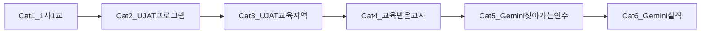

# CMS API gaps·conversion·settlement dummy(md) 이관 SSOT

이관일: 2026-10-10
원본 수: 21

원본 경로 목록:

- `apps/cms/docs/api/settlement-item-settings-dummy-seed-backend-request.md`
- `apps/cms/docs/api/data-management-api-backend-gaps.md`
- `apps/cms/docs/api/forms-surveys-api-backend-gaps.md`
- `apps/cms/docs/api/gemini-recruitment-patch-invalid-value-instant-backend-prompt-2026-09-30.md`
- `apps/cms/docs/api/logs-api-backend-gaps.md`
- `apps/cms/docs/api/logs-api-conversion-status-backend-handoff.md`
- `apps/cms/docs/api/posts-api-backend-gaps.md`
- `apps/cms/docs/api/programs-api-backend-gaps-consolidated.md`
- `apps/cms/docs/api/programs-api-backend-gaps.md`
- `apps/cms/docs/api/programs-api-conversion-roadmap.md`
- `apps/cms/docs/api/programs-api-remaining-work.md`
- `apps/cms/docs/api/programs-company-school-detail-api-conversion-status.md`
- `apps/cms/docs/api/programs-detail-api-conversion-status.md`
- `apps/cms/docs/api/programs-gemini-performance-api-conversion-status.md`
- `apps/cms/docs/api/programs-gemini-visiting-training-api-conversion-status.md`
- `apps/cms/docs/api/programs-trained-teachers-api-conversion-status.md`
- `apps/cms/docs/api/programs-ujat-detail-api-conversion-status.md`
- `apps/cms/docs/api/programs-ujat-education-regions-api-conversion-status.md`
- `apps/cms/docs/api/settlement-api-backend-gaps.md`
- `apps/cms/docs/api/templates-api-conversion-status-backend-handoff.md`
- `apps/cms/docs/api/trained-teacher-registration-flow-backend-prompt-2026-09-18.md`

---

### Source: `apps/cms/docs/api/settlement-item-settings-dummy-seed-backend-request.md`

# 정산 항목 설정 더미 시드 요청 (BE)

> **SUPERSEDED (2026-08-27):** 본 문서·[`settlement-item-settings-seed.payload.json`](./settlement-item-settings-seed.payload.json)은 **구 v1 (15건)** 이다. 사용하지 마라.
>
> **현행 SSOT:**
> - API·시드 핸드오프: **[settlement-item-settings-backend-seed-handoff-2026-08-27.md](./settlement-item-settings-backend-seed-handoff-2026-08-27.md)**
> - PUT payload v2: **[settlement-item-settings-seed-v2.payload.json](./settlement-item-settings-seed-v2.payload.json)**
> - 산출·enum: **[settlement-item-settings-category-backend-cursor-prompt.md](./settlement-item-settings-category-backend-cursor-prompt.md)**

> **2026-08-26 카탈로그 SSOT 이전:** 임금 6 · 지급 6 · 공제 1 및 산출 엔진 수정은 **[settlement-item-settings-category-backend-cursor-prompt.md](./settlement-item-settings-category-backend-cursor-prompt.md)** 를 사용하라. 본 문서 CASE-05~07·13(보조·다수인출강·단순인건비·회의참석비)과 `교통비 (1사1교)` 카드는 **구버전**이다.

CMS **정산 관리 → 정산 항목 설정** 화면의 카드 목록·상세 모달을 FE mock과 동일하게 검증할 수 있도록, **current config 1건 + item 15건** 더미 시드를 요청합니다.

| 항목 | 값 |
|------|-----|
| **작성일** | 2026-07-21 · **갱신** 2026-07-31 |
| **대상 화면** | LNB `정산 관리` → `정산 항목 설정` |
| **FE path** | `/settlement-management/item-settings` |
| **API** | `GET /api/admin/settlement-configs/current` (Orval / OpenAPI) |
| **모듈 플래그** | `VITE_REAL_API_MODULES=...,settlementConfigs` |
| **FE SSOT** | [`settlement-item-settings.ts`](../../src/data/mock/settlement-item-settings.ts) · [`settlement-item-setting-detail.mock.ts`](../../src/data/mock/settlement-item-setting-detail.mock.ts) |
| **BE 복붙 페이로드** | [`settlement-item-settings-seed.payload.json`](./settlement-item-settings-seed.payload.json) — CASE-01~15 + `detailJson` 객체 |

**관련 문서**

- [settlement-api-integration.md](./settlement-api-integration.md) — 조회 연동
- [settlement-api-backend-gaps.md](./settlement-api-backend-gaps.md) §9 — CRUD·layout 상세 필드 갭
- [settlement-item-setting-detail-modal-variants-spec.md](../../.cursor/rules/process/settlement-item-setting-detail-modal-variants-spec.md) — 상세 모달 변형

**Notion (CMS 기능정의서 · 화면=`정산 항목 설정`)**

| 페이지 | URL | 기획 상태 |
|--------|-----|-----------|
| 목록 개요 | https://app.notion.com/p/33af3e2a77d080ea8313e6df4aa2e538 | 프론트 완료 / 백엔드 확인 |
| 임금 항목 | https://app.notion.com/p/33af3e2a77d08024adb9dec30e3cd0de | 백엔드 확인 |
| 지급 항목 | https://app.notion.com/p/33af3e2a77d080fba08cc349ab4b8b5f | 백엔드 확인 |
| 공제 항목 | https://app.notion.com/p/33af3e2a77d080f89c02da51f89e0a62 | 개발 확인 완료 |
| 1~3급 상세 | https://app.notion.com/p/389f3e2a77d080f0b739c123618f04ed | 백엔드 확인 |
| 특강·기타 | https://app.notion.com/p/389f3e2a77d080b5965ef04114e3e58f | 백엔드 확인 |
| 제미나이 강사비 | https://app.notion.com/p/389f3e2a77d0802b84a5f7b1cefdba95 | 백엔드 확인 · FE mock `w-gemini` (v2 카탈로그) |
| 교통비 | https://app.notion.com/p/389f3e2a77d080a1841ff48d08cfa364 | 백엔드 확인 |
| 숙박비 | https://app.notion.com/p/389f3e2a77d0805580cbf9fd6a659a1e | 백엔드 확인 |
| 식사비 | https://app.notion.com/p/389f3e2a77d080edb8b2c577f605127d | 백엔드 확인 |
| 활동비 | https://app.notion.com/p/389f3e2a77d08042a95cc0fab74fc244 | 백엔드 확인 |

> **중요:** 프로그램 시드처럼 row를 여러 개 만드는 구조가 **아닙니다**.  
> **SettlementConfig current 1건** 안에 `wageItems`(7) + `paymentItems`(7) + `deductionItems`(1) = **15 items** 를 넣으면 됩니다.  
> OpenAPI에 `detailJson?: string` 이 있으므로 layout 전용 필드는 **stringify된 JSON**으로 실어 주세요 (§6.4 · payload 파일).

---

## 0. 이 문서를 읽는 법

1. **§1 Config envelope** 를 만든다.
2. **§2 마스터 리스트**의 CASE-01~15를 `wageItems` / `paymentItems` / `deductionItems`에 채운다.
3. 각 CASE의 **시드 레시피**(§4) 수치·문구를 FE mock과 동일하게 맞춘다.
4. **§3 layout 잠금표**로 상세 모달 UI가 열리는지 확인한다.
5. 우선순위: **P0(01~15) → P1 갭(16~20)**.

```text

#### Marker lines (excerpt)
```
| **CASE-01** | `w-1` | `1급 강사비` | wage | `tier1` | `TIER1` | 급수 강사비 SSOT · 한도 50만 |
3. layout 전용 필드(`multiInstructor*` 등)를 **어느 JSON 경로**에 실었는지 (또는 rateItems 규칙)
4. P1(CASE-16~20) 수용 여부
| 역할 | 경로 |
```

---

### Source: `apps/cms/docs/api/data-management-api-backend-gaps.md`

# 데이터 관리 — 백엔드 갭 요청

CMS LNB **데이터 관리** 3화면(후원사·교재·세부 프로그램)의 OpenAPI v9 대조 결과입니다.  
프론트 연동 명세: [data-management-api-integration.md](./data-management-api-integration.md)  
더미 시드: [data-management-dummy-seed-backend-request.md](./data-management-dummy-seed-backend-request.md)

**후원사 관리 API 수정(2026-09-03 UI 정렬 이후)는 [sponsor-management-api-backend-handoff.md](./sponsor-management-api-backend-handoff.md)를 SSOT로 본다.**  
아래 표의 후원사 항목(B-2 누적 금액·상태 enum·홈페이지/로고 등)은 그 문서 기준으로 갱신됐다. 본 문서는 교재·세부 프로그램·공통 잔여와 이력 삭제(P0) 인덱스로 유지한다.

**작성일**: 2026-08-24 · **갱신**: 2026-09-03  
**OpenAPI**: `apps/cms/openapi/data-management.openapi.json`

프론트는 목록 CRUD를 이미 호출합니다. 아래는 **스펙에 없는 API**, **있는 API의 계약 구멍**, **확인만 필요한 항목**입니다.

이력 삭제(P0)는 [cms-table-bulk-delete-api-backend-handoff.md](./cms-table-bulk-delete-api-backend-handoff.md) §4 #18과 동일 건입니다. **이 문서를 SSOT**로 봐 주세요.

---

## 전환 phase 체크리스트 (BE 핸드오프)

| Phase | BE 작업 | FE 후속 |
|-------|---------|---------|
| **B-0** | — | ✅ 성능(placeholderData·Spin·kit 지연 등) |
| **B-1** | 후원사 목록 **Page** (`page`/`size`/`total`) | 페이지네이션 UI |
| **B-2** | 목록 **누적 후원금·수혜자** 컬럼 | adapter |
| **B-3** | 교재·세부 `total` 신뢰 + size 정책(50/100) | FE size 축소 |
| **B-4** | 본 문서 A/B 잔여(이력 삭제·export·키트 규칙 등) | 순차 연동 |
| **B-5** | options/matches 안정화 | 프로그램 폼 mock→API (별 PR) |

로컬 데모 데이터: [시드 요청](./data-management-dummy-seed-backend-request.md) (mock SSOT, upsert·중복 방지).

---

## Notion 기획(노란) ↔ gap 매핑

FE는 2026-08-26 Notion 정렬에서 **API로 가능한 UI만** 맞췄습니다. 아래는 기획 노란/취소선 잔여와 본 문서 gap ID 대응입니다.

| 화면 | Notion 항목 | 조치 | Gap / 비고 |
|------|-------------|------|------------|
| 후원사 목록 | 누적 후원금·수혜자 컬럼 | BE 대기 | **P1** / **B-2** |
| 후원사 목록 | 후원 상태 논의중·휴면 | **GO 완료 (2026-09-07)** — FE·BE `active`\|`discussing`\|`dormant`\|`ended` | [4종 GO 프롬프트](./sponsor-sponsorship-status-4way-backend-cursor-prompt.md) |
| 후원사 목록 | 주 담당자 연락처 | ~~취소~~ FE **제거 완료** | — |
| 후원사 상세 | 홈페이지·로고·비고·로고 일괄 DL | BE 대기 | **P2** |
| 후원사 상세 | 소재지 시군구 분리 | FE는 AddressSearch+상세 단일 유지 | 잔여 UX (요청 우선순위 낮음) |
| 후원사 이력 | 총 수혜자 컬럼 | BE 대기 | DTO 확장 필요 (P1급) |
| 후원사 이력 | 이력 삭제 | BE 대기 | **P0** |
| 후원사 이력 | ~~참여자 모집 인원~~ | FE **제거 완료** | — |
| 교재 | 사업 분야 관리 CRUD | ✅ FE 연동 완료 | — |
| 교재·후원사 | 서버 엑셀 export | BE 대기 | **P2** |
| 공통 | 목록 Page(후원사) | BE 대기 | **P1** / **B-1** |

---

## 현재 OpenAPI vs FE

### 후원사 (`/sponsor`)

| Method | Path | FE |
|--------|------|----|
| GET/POST | `/api/admin/sponsors` | 목록·등록 — 배선됨 |

#### Marker lines (excerpt)
```
| GET/PATCH/DELETE | `/api/admin/detailed-programs/{detailedProgramId}` | 수정·단건 삭제 — 배선됨 |
| 우선 | 제안 경로 | 이유 |
| **P1** | 목록 DTO에 **누적 후원금·누적 수혜자** (또는 연도별 합산 규칙 명시) | Notion 목록 컬럼(노란 하이라이트). `SponsorResponse`에 없음 → **B-2** |
| **P2** | 후원사 상세 `homepage`, 로고 업로드/삭제/일괄 다운로드 | Notion 노란 하이라이트. 상세 DTO에 없음 |
```

---

### Source: `apps/cms/docs/api/forms-surveys-api-backend-gaps.md`

# 템플릿 양식 API — 백엔드 핸드오프 (갭·미구현·스펙 불일치)

> **SSOT**: 전환률 · 탭별 계약 · 미적용 API 스펙은  
> [**templates-api-conversion-status-backend-handoff.md**](./templates-api-conversion-status-backend-handoff.md)  
> 본 문서는 2026-07 갭 목록입니다. 작성 시드 종수(27) 등은 카탈로그가 **32종**으로 늘었습니다. 백엔드 전달 시 위 문서를 우선하세요.

CMS `/templates/form-management` 작성·발급 양식 mock → `forms-surveys` API 전환 시, **백엔드에 요청·확인이 필요한 항목** 목록입니다.

OpenAPI 기준: `openapi/backend.openapi.json` (v9) · subset `openapi/forms-surveys.openapi.json` (19 paths)  
JSON 계약 SSOT: [form-template-json-contract.md](./form-template-json-contract.md)  
연동 명세: [forms-surveys-api-integration.md](./forms-surveys-api-integration.md)  
마이그레이션 PHASE: [forms-surveys-api-migration-guide.md](./forms-surveys-api-migration-guide.md)  
**신규 템플릿 생성 전용**: [template-create-api-backend-handoff-2026-10-07.md](./template-create-api-backend-handoff-2026-10-07.md)

**작성일**: 2026-07-01  
**Swagger 서버 스냅샷**: `https://6920-221-146-247-18.ngrok-free.app//`

---

## 요약 (백엔드 담당 한눈에)

| 구분                   | 설명                                                                                                                |
| ---------------------- | ------------------------------------------------------------------------------------------------------------------- |
| **라우트는 있음**      | `form-templates` / `form-template-versions` / `form-responses` / `form-bindings` 등 19 path — Swagger 「구현 완료」 |
| **당장 막는 갭 (P0)**  | **DB 시드 없음**, enum·`versionStatus` 미문서화, 목록 DTO에 `latestVersionId` 없음                                  |
| **API 자체 없음 (P1)** | 양식 **로고·인장·수료증 배경** 설정, **overlay/editorState** 저장, **발급(ISSUANCE) 시드**                          |
| **연동 대기 (P2)**     | form-bindings·responses **관리 UI**용 운영 API, 프로그램 신청 **커스텀 필드** 도메인                                |

> 프론트는 `forms-surveys` 인프라(Orval·서비스·어댑터)를 준비했으나, **`.env`에 `formsSurveys` 미포함** — P0 시드·계약 전에는 실 API 전환을 시작하지 않습니다.

---

## 우선순위 요약

| 우선순위 | 건수 | 대표 항목                                                                                     |
| -------- | ---- | --------------------------------------------------------------------------------------------- |
| **P0**   | 5    | 27종 templateCode 시드, enum·versionStatus 문서화, `latestVersionId`, 스테이징 smoke          |
| **P1**   | 6    | overlay/editorState 필드, 양식 설정(파일) API, ISSUANCE 시드, copy 응답 `templateCode`        |
| **P2**   | 5    | form-bindings CMS UI, responses 테스트 UI, program-draft 연동, 커스텀 필드, 일괄 마이그레이션 |

---

## 참고 — OpenAPI에 존재하는 forms-surveys 경로 (19)

프론트 Orval subset 기준. **「API 없음」이 아니라 「FE 미연동」** 인 항목과 구분합니다.

| Method           | Path                                                        | FE 연동 PHASE                              |
| ---------------- | ----------------------------------------------------------- | ------------------------------------------ |
| GET              | `/api/admin/form-templates`                                 | PHASE 1 ✅ 준비                            |
| POST             | `/api/admin/form-templates`                                 | PHASE 4 (신규 양식)                        |
| GET/PATCH/DELETE | `/api/admin/form-templates/{templateId}`                    | PHASE 4                                    |
| GET/POST         | `/api/admin/form-templates/{templateId}/versions`           | PHASE 2                                    |
| POST             | `/api/admin/form-templates/{templateId}/versions/copy`      | PHASE 3                                    |
| POST             | `/api/admin/form-templates/versions/{versionId}/publish`    | PHASE 3                                    |
| GET/PUT          | `/api/admin/form-template-versions/{versionId}`             | PHASE 2                                    |
| POST             | `/api/admin/form-template-versions/{versionId}/publish`     | PHASE 3 (중복 publish 경로 — 아래 갭 참고) |
| GET/POST         | `/api/admin/form-templates/responses`                       | PHASE 6                                    |
| GET/POST         | `/api/admin/form-responses` …                               | PHASE 6                                    |
| POST             | `/api/admin/form-responses/submit`                          | PHASE 6                                    |
| GET/POST         | `/api/admin/programs/{programId}/form-bindings`             | PHASE 6                                    |

#### Marker lines (excerpt)
```
| PATCH/DELETE     | `/api/admin/programs/{programId}/form-bindings/{bindingId}` | PHASE 6                                    |
## P0 — PHASE 0 차단 (시드·계약·기존 DTO 보완)
**시드 표 (SSOT)**
| **현재 DTO**         | `FormTemplateListItemResponse`: `latestVersionNo`, `latestVersionStatus`만 있음 — **`templateVersionId` 없음** |
| **갭 유형**              | **BE DB 시드 등록 대기**. FE 시드 JSON: P0 지급조서 2종 + `document-3` 완료, 잔여 10종 미작성 |
**발급 templateCode (FE SSOT — BE 합의 필요)**
### 10. publish API 경로 **2종** — canonical 정리
| **현재**          | mock `getFormTemplateByProgramId()`                                    |
| **API**     | `GET/POST /api/admin/programs/{programId}/form-bindings` 등 — **존재** |
```

---

### Source: `apps/cms/docs/api/gemini-recruitment-patch-invalid-value-instant-backend-prompt-2026-09-30.md`

# Cursor prompt — Gemini 모집 PATCH `INVALID_VALUE` (date-only `*At` vs Instant 검증)

| 항목 | 값 |
|---|---|
| 대상 레포 | **JABACK만** (프론트 `jakorea` 에서 이 버그를 고치지 마라) |
| 작업 위치 | 백엔드 프로젝트에서 이 프롬프트를 열어 구현·테스트·커밋한다 |
| 주 API | `PATCH /api/admin/gemini/trainings/recruitments/{programId}` |
| 재현 ID | `185002` (LocalDemo Gemini Primary Case GEM-02) |
| traceId 예 | `f2045c7273554e3282f8dbbadedee17f` |
| 프로그램 유형 | `GEMINI_TRAINING` 만. GENERAL / UJAT Instant 검증 회귀 금지 |
| 우선순위 | **P0** (모집 공고 정보 저장 불가) |
| 작성일 | 2026-09-30 |
| 상태 | **BE 완료 (2026-09-30).** FE 코드 변경 없음. QA만 |
| FE handoff (완료 후) | `JABACK/docs/frontend/gemini-recruitment-patch-invalid-value-instant-frontend-handoff-2026-09-30.md` |

**이 문서는 백엔드 Cursor/에이전트용이다. FE 레포에서 SchemaValidator·Normalizer를 직접 고치지 마라.**

---

## 한줄

Gemini PATCH가 `serviceDetailJson`에 **날짜만**(`YYYY-MM-DD`) 올린 `trainingRequestStartAt` / `trainingRequestEndAt` 을 넣은 뒤,  
`ProgramServiceDetailSchemaValidator` 가 `Instant.parse` 로만 검증해서  
`serviceDetailJson.trainingRequestStartAt must be an ISO-8601 instant.` → `GENERIC_MUST_PATTERN` → CMS에는 `INVALID_VALUE` / `입력값 또는 요청 조건을 확인해 주세요.` / `field: null` 로만 보인다.

---

## 재현

1. CMS에서 Gemini 모집 공고 `185002` 정보 수정 → 저장.
2. 요청 body 요지 (FE가 실제로 보냄 — FE를 바꾸지 마라):

```json
{
  "title": "제미나이 찾아가는 연수 모집 예정",
  "applicationStartDate": "2026-10-07",
  "applicationEndDate": "2026-10-28",
  "businessStartDate": "2026-10-07",
  "businessEndDate": "2026-10-28",
  "trainingRequestStartDate": "2026-10-30",
  "trainingRequestEndDate": "2026-12-29",
  "educationForm": "online",
  "educationStructure": "SCHEDULE",
  "applicationMethod": "모집 기간 내 온라인 신청 후 담당자 확인을 거칩니다.",
  "targetLevels": ["adult"],
  "contactPhone": "02-1234-5678",
  "serviceDetailJson": "{\"geminiRecruitment\":{\"trainingRequestPeriodStart\":\"2026-10-30\",\"trainingRequestPeriodEnd\":\"2026-12-29\", ...}}"
}
```

3. 응답:

```json
{
  "success": false,
  "message": "입력값 또는 요청 조건을 확인해 주세요.",
  "error": {
    "code": "INVALID_VALUE",
    "field": null,
    "traceId": "..."

#### Marker lines (excerpt)
```
Gemini 연수 요청 기간은 **date SSOT** 이다.
| 교육 대상 | `targetLevels` **전체 배열** + `targetLevel` = `[0]` | `targetLevels` | **`stampTargetLevels(List.of(첫 값))` 금지.** 요청 `targetLevels` 전체를 root·`geminiRecruitment.educationTargetLevels`에 저장. 코드는 `adult`\|`university`\|… |
- 이 문서 경로 (FE 보관용): `apps/cms/docs/api/gemini-recruitment-patch-invalid-value-instant-backend-prompt-2026-09-30.md`  
```

---

### Source: `apps/cms/docs/api/logs-api-backend-gaps.md`

# 보안 설정(로그 관리) — 백엔드 갭 요청

> **2026-08-26 SSOT**: 백엔드 Cursor 실행 프롬프트는  
> [**logs-api-backend-cursor-prompt.md**](./logs-api-backend-cursor-prompt.md)  
> 전환률 · 화면별 계약 · 미적용 API 스펙 스냅샷: [**logs-api-conversion-status-backend-handoff.md**](./logs-api-conversion-status-backend-handoff.md)  
> FE 연동: [logs-api-integration.md](./logs-api-integration.md)

CMS LNB **보안 설정(로그 관리)** 4화면의 OpenAPI 대조입니다.

**작성일**: 2026-08-26  
**OpenAPI**: `apps/cms/openapi/logs.openapi.json` (tag: 로그 관리)

프론트는 목록 GET 4종을 OpenAPI로 호출합니다. **회원 로그인 mock fallback은 제거됨** — 실패 시 에러 UI만 표시합니다.

---

## 현재 OpenAPI vs FE

| Method | Path | FE |
|--------|------|----|
| GET | `/api/admin/logs/member-logins` | 회원 로그인 이력 — 배선됨, mock 없음 |
| GET | `/api/admin/logs/file-access` | 파일 다운로드 이력 — 배선됨 |
| GET | `/api/admin/logs/privacy-access` | 개인정보 조회 이력 — 배선됨 |
| GET | `/api/admin/logs/system-issues` | 버그/이슈 이력 목록 — 배선됨 |
| GET | `/api/admin/logs/system-issues/{issueId}` | OpenAPI만. CMS 상세 없음 — FE 미연결 (기획: 행 액션 없음) |
| PATCH | `/api/admin/logs/system-issues/{issueId}/status` | OpenAPI만. CMS UI 미연결 |

Notion **메일 발송 이력**은 기획 보류이며 OpenAPI에 없습니다.

---

## A. 남아 있는 API 요청

| 우선 | 제안 경로 | 이유 |
|------|-----------|------|
| **P0** | `GET /api/admin/logs/member-logins` **구현·스테이징 200** + **1개월 서버 파기** | OpenAPI·FE 배선 완료. 404면 CMS가 빈 mock이 아니라 에러를 보여 줌 |
| **P0** | 목록 query `params` 가방 **required 제거**, 플랫 키만 바인딩 | FE는 `?fileName=` `?adminName=` 만 보냄 |
| **P0** | 파일 다운로드 API가 `file-access` 행을 **자동 적재** | 서버 relay/export 성공 시. CMS는 GET path에 POST하지 않음 |
| **P0** | `POST /api/admin/logs/file-access/client` | FE blob(엑셀·지급조서 등) 저장 직전 감사. **동일 저장소** insert. 상세: [client-file-access-log-backend-handoff.md](./client-file-access-log-backend-handoff.md) |
| **P0** | unmask 성공 시 `privacy-access` 감사 + `targetName` | 조회 대상 컬럼. 경로 `/api/admin/users/{id}/privacy/unmask` |
| P1 | 네 목록 GET을 **Page 응답**으로 바꾸거나 `page`, `size`, `total` 추가 | 현재 무한 배열. 로그 적재 시 화면이 전체를 받음 |
| P1 | `GET /api/admin/logs/{file-access\|privacy-access\|system-issues\|member-logins}/export` (필터 동일, **감사 fail-closed**) | 지금은 클라 테이블 dump. 개인정보·IP 포함 |
| P2 | `GET /api/admin/logs/system-issues/{issueId}/stack-trace` 또는 상세에 `stackTrace` 본문 포함 | OpenAPI 상세에 `stackTraceAvailable`만 있음. CMS UI는 상세를 열지 않음 |
| P2 | `GET /api/admin/logs/mail-sends` (가칭) | Notion 메일 발송 이력(보류). 필터: 사용자, 기간 / 컬럼: No, 발생 화면, 에러 메시지, 사용자, 발생일시 |

**요청하지 않는 것**

- `POST /api/admin/logs/file-access` (**GET과 동일 path**) — 목록 GET 전용. 스테이징 405. 클라이언트 적재는 `/file-access/client`만.
- `POST /logs/privacy-access` — 회원 unmask API가 이미 감사 생성.
- 대시보드 `GET /api/admin/dashboard/log-alerts` — v9에서 삭제됨, 로그 LNB 아님.

---

## B. 있는 API의 스펙 구멍 (계약 수정)

### 1. `params` 가방 required 제거 (P0)

플랫 키는 OpenAPI에 이미 있다. 그런데 `params: { [key: string]: string }` 가 **required**로 남아 있다. FE는 가방을 보내지 않고 `?fileName=` `?adminName=` 만 보낸다. Spring이 중첩 `params[fileName]`만 받으면 필터가 무시된다.

프론트가 보내는 키(확정안):

#### Marker lines (excerpt)
```
목록 `id`는 int64로 맞춰짐. 상세 path도 int64. CMS는 상세를 호출하지 않음 (기획: 행 액션 없음). `screenName`은 DTO에 남아도 됨 — **CMS 컬럼에서는 제거됨**.
DTO에 있음. Notion 컬럼에는 없음. CMS는 표시하지 않음.
```

---

### Source: `apps/cms/docs/api/logs-api-conversion-status-backend-handoff.md`

# 보안 설정(로그 관리) — API 전환률 · 미적용 API (백엔드 핸드오프)

> **2026-08-26**: 이 문서는 2026-08-24 스냅샷입니다.  
> 백엔드가 **지금 실행할 작업**은 [**logs-api-backend-cursor-prompt.md**](./logs-api-backend-cursor-prompt.md) 를 따르세요.  
> FE는 `GET /member-logins` mock fallback을 제거했습니다. OpenAPI에 목록 4종 + Page 래퍼 + `targetName`이 이미 있습니다.  
> 전환률·요청 스펙의 상세 스냅샷은 본 문서입니다. 관련: [logs-api-integration.md](./logs-api-integration.md) · [logs-api-backend-gaps.md](./logs-api-backend-gaps.md)

**대상 독자**: 백엔드  
**작성일**: 2026-08-24  
**범위**: CMS LNB **보안 설정(로그 관리)** 하위 4화면만. 프로그램 유형·데이터 관리·정산은 제외.  
**OpenAPI 스냅샷**: `apps/cms/openapi/logs.openapi.json` (tag: 로그 관리, spec **v9**)  
**FE 연동 코드**: `apps/cms/src/features/logs/**`, `apps/cms/src/pages/logs/**`  
**관련**: [logs-api-integration.md](./logs-api-integration.md) · [logs-api-backend-gaps.md](./logs-api-backend-gaps.md) (짧은 갭 목록. **전환률·요청 스펙은 본 문서가 SSOT**)

게이트: `VITE_REAL_API_MODULES`에 `logs` + MFA 완료 JWT (`hasRemoteAdminJwt()`).  
권한: FE 403 카피는 **MASTER 전용**. OpenAPI 본문은 “별도 세부 권한 없음”. **RBAC 코드(`LOG_READ` / `LOG_WRITE` 등)를 OpenAPI에 명시해 주세요.**

---

## 0. 한 장 요약 (백엔드 액션)

| ID | 우선 | 요청 | 영향 화면 |
|----|------|------|-----------|
| **L-09** | **P0** | `GET /api/admin/logs/member-logins` **OpenAPI 등재 + 구현**. 지금 FE가 이 경로를 칩니다. 404 등 실패 시 **mock 130건**이 보여 **운영 데이터가 아닙니다** | 회원 로그인 이력 |
| **L-01** | **P2** | 목록 `BugIssueLogFrontendResponse.id`(string)와 상세/PATCH `issueId`(int64) **동일 식별자·동일 타입** | OpenAPI 상세·PATCH는 있으나 **CMS UI 미연결**. 나중에 붙일 때 UUID면 호출 불가 |
| **L-02** | **P0** | `PersonalInfoAccessLogFrontendResponse.targetName` (열람 대상자 명) | 개인정보 조회 이력 「조회 대상」컬럼이 없으면 항상 `-` |
| **L-03** | **P0** | 목록 3종 query `params` 가방 → **키를 스키마 property로 명시**. Axios 중첩 `params[fileName]` vs 플랫 `fileName` **바인딩 확인** | 파일·개인정보·버그 필터가 서버에 안 먹을 수 있음 |
| **L-04** | **P2** | `PATCH .../status`의 `status` **enum + 409 전이 규칙** | OpenAPI 있음, **CMS UI 미연결** |
| **L-05** | **P1** | 목록 **Page** (`page`, `size`, `totalElements`) — 현재 무한 배열 | 로그 적재 시 화면이 배열 전체를 받음 |
| **L-06** | **P1** | 목록 **export** (필터 동일, **감사 fail-closed**). 지금은 클라 테이블 dump | 4화면 엑셀. 개인정보·IP 포함 |
| **L-07** | **P2** | 상세 `stackTrace` 본문 또는 `GET .../stack-trace` | CMS UI가 상세를 열지 않음. `stackTraceAvailable`만 있음 |
| **L-10** | **P1** | 버그 **목록** DTO에 `issueStatus` / `severity` | 행을 안 열면 상태 배지 불가 (Notion: 행 액션 없음) |
| **L-08** | **P2** | `GET /api/admin/logs/mail-sends` (가칭) | Notion 메일 발송 이력 — **기획 보류, LNB 없음** |

**요청하지 않음**

- `POST /logs/file-access` — 파일 다운로드 시 **서버가 적재**. CMS는 조회 전용.
- `POST /logs/privacy-access` — 회원 unmask API가 감사 생성.
- 대시보드 `GET /api/admin/dashboard/log-alerts` — v9 삭제, 이 LNB 아님.
- `/api/files/access-logs` — 파일 도메인. 로그 관리 화면과 무관.

---

## 1. 전환률 (두 축)

가중: LNB 하위 **4화면 균등**.  
숫자는 추정치이며, **백엔드 계약이 화면 기획을 충족하는 비율**과 **FE가 실제로 호출하는 비율**을 나눕니다.

### 1.1 화면별

| LNB 화면 | CMS 경로 | FE 목록 GET | OpenAPI | **백엔드 계약 완료율** | **FE 배선률** | 한 줄 |
|----------|----------|-------------|---------|----------------------:|-------------:|------|
| 회원 로그인 이력 | `/logs/member-login-history` | handwritten + **실패 시 mock 130건** | **미등재** | **~35%** | **~40%** (경로만 추정 호출) | 스펙·DTO 없음. 운영에서 mock이 섞일 수 있음 |
| 파일 다운로드 이력 | `/logs/file-download-history` | 실호출, mock 없음 | 목록 GET 있음 | **~70%** | **~90%** (목록만) | 필터 스키마·Page·export 없음 |
| 개인정보 조회 이력 | `/logs/personal-info-access-history` | 실호출, mock 없음 | 목록 GET 있음 | **~60%** | **~85%** (목록만) | `targetName` 없음. 클라 엑셀이 감사 정책과 충돌 가능 |
| 버그/이슈 이력 | `/logs/bug-issue-history` | 목록만 실호출, mock 없음 | 목록+상세+PATCH 있음 | **~70%** | **~55%** (목록만. 상세·PATCH **화면 미배선**) | id 타입·enum·스택·목록 상태 필드 구멍 |

**LNB 균등 평균**

| 축 | 수치 | 의미 |

#### Marker lines (excerpt)
```
**화면 컬럼 vs DTO**
| 용도 | FE 경로 (참고) |
경로 prefix(`/api/users` vs `/api/admin/users`)가 어긋나면 감사도 안 쌓일 수 있습니다.
| `apiPath` | API 경로 |
FE 임시 제안 라벨: 열림 / 처리 중 / 해결 / 종료. **서버 enum이 SSOT** — 다르면 알려 주세요.  
§2.1. 지금 FE가 이미 이 경로를 칩니다. 없으면 404 → mock.
감사 실패 → 200 금지, 5xx/전용 코드.  
전이 표(예: CLOSED → OPEN 금지)를 409와 함께 문서화. FE 임시값과 다르면 **서버 enum이 SSOT**.
1. `GET /api/admin/logs/member-logins` 구현 여부 · 예정 경로.
5. unmask 실경로가 `/api/users/...`인지 `/api/admin/users/...`인지.
| 역할 | 경로 |
| DTO 맵 | `features/logs/api/adapters/logs-adapters.ts` |
공통 래퍼: `success`, `message`(한국어), `error.code` / `error.message`.
```

---

### Source: `apps/cms/docs/api/posts-api-backend-gaps.md`

# 게시글 관리 — 백엔드 갭 요청

CMS LNB **게시글 관리** 3화면(공지·FAQ·문의)의 OpenAPI v9 대조 결과입니다.

- 프론트 연동 명세: [posts-api-integration.md](./posts-api-integration.md)
- 더미 시드: [posts-dummy-seed-backend-request.md](./posts-dummy-seed-backend-request.md)
- 시드 Cursor 프롬프트 (G1–G4 포함): [posts-dummy-seed-backend-cursor-prompt.md](./posts-dummy-seed-backend-cursor-prompt.md)

**작성일**: 2026-08-26  
**OpenAPI**: `apps/cms/openapi/posts.openapi.json`

프론트는 목록 CRUD를 이미 호출합니다. 아래는 **스펙에 없는 API**, **있는 API의 계약 구멍**입니다.

G1–G4는 시드 검증에 필요합니다. 시드 프롬프트를 이미 실행했다면 이 블록은 건너뛰세요.  
G5–G8은 기획 노란 강조 / FE 후속 연동입니다. **OpenAPI만 먼저** 추가해도 됩니다.

---

## 현재 OpenAPI vs FE

### 공지 (`/admin/posts/notices`)

| Method           | Path                                                | FE                               |
| ---------------- | --------------------------------------------------- | -------------------------------- |
| GET/POST         | `/api/admin/content/notices`                        | 목록·등록 — 배선됨               |
| GET/PATCH/DELETE | `/api/admin/content/notices/{noticeId}`             | 상세·수정·삭제 — 배선됨          |
| POST             | `/api/admin/content/notices/bulk-delete`            | OpenAPI만. FE는 단건 DELETE 루프 |
| GET/POST         | `/api/admin/content/notice-categories`              | 카테고리 모달 — 배선됨           |
| PATCH/DELETE     | `/api/admin/content/notice-categories/{categoryId}` | 카테고리 모달 — 배선됨           |

### FAQ (`/admin/posts/faq`)

| Method                | Path                                  | FE                          |
| --------------------- | ------------------------------------- | --------------------------- |
| GET/POST              | `/api/admin/content/faqs`             | 목록·등록 — 배선됨          |
| GET/PATCH/DELETE      | `/api/admin/content/faqs/{faqId}`     | 상세·수정·삭제 — 배선됨     |
| POST                  | `/api/admin/content/faqs/bulk-delete` | OpenAPI만. FE는 단건 DELETE |
| GET/POST/PATCH/DELETE | `/api/admin/content/faq-categories`   | 카테고리 모달 — 배선됨      |

### 문의 (`/admin/posts/inquiries`)

| Method   | Path                                                  | FE                                                |
| -------- | ----------------------------------------------------- | ------------------------------------------------- |
| GET      | `/api/admin/inquiries`                                | 목록 — 배선됨 (`status`, `programId`만 서버 필터) |
| GET      | `/api/admin/inquiries/{inquiryId}`                    | 상세 — 배선됨                                     |
| DELETE   | `/api/admin/inquiries/{inquiryId}`                    | 단건 삭제 — 배선됨                                |
| POST     | `/api/admin/inquiries/bulk-delete`                    | 2건 이상 삭제 — 배선됨                            |
| GET/POST | `/api/admin/inquiries/{inquiryId}/answers`            | 답변 목록·등록 — 배선됨                           |
| PATCH    | `/api/admin/inquiries/{inquiryId}/answers/{answerId}` | 기존 답변 수정 — 배선됨                           |
| GET/POST | `/api/admin/inquiry-categories`                       | 카테고리 모달 — 배선됨                            |
| PATCH/DELETE | `/api/admin/inquiry-categories/{categoryId}`      | 카테고리 모달 — 배선됨                            |

---

## Notion 기획 ↔ gap

| 화면       | Notion                    | 조치                               | Gap           |
| ---------- | ------------------------- | ---------------------------------- | ------------- |
| 문의 목록  | 카테고리 관리 팝업        | FE 배선됨. 사용 중 삭제는 409(G4)  | **G4**        |
| 문의 상세  | 문의 회원명·연락처·이메일 | FE `회원 #id` / `-`                | **G2**        |

#### Marker lines (excerpt)
```
OpenAPI에 경로를 추가하라. 권한은 기존 문의 쓰기와 같게.
구현하되 이번엔 OpenAPI + DTO만 먼저 해도 된다. 파일 스토리지 연동이 크면
NoticeResponse에 attachments 배열만 추가하고 upload는 TODO로 남겨라.
기존 status / programId 계약을 깨지 마라.
- createdFrom, createdTo (날짜, inclusive)
- createdFrom, createdTo
```

---

### Source: `apps/cms/docs/api/programs-api-backend-gaps-consolidated.md`

# 프로그램 관리 API — 백엔드 통합 핸드오프 (Cat1–6)

| 항목 | 값 |
|------|-----|
| 작성일 | 2026-07-16 |
| 대상 | 백엔드 / API 설계 · OpenAPI · 스테이징 |
| FE 로드맵 | [programs-api-conversion-roadmap.md](./programs-api-conversion-roadmap.md) |
| OpenAPI 대조 기준 | `apps/cms/openapi/backend.openapi.json` |
| 목적 | **API 부재 · 계약 미비 · FE 적용을 수월하게 하는 상세 요청**을 한 문서로 전달 |

> 카테고리별 세부 계약은 기존 handoff를 SSOT로 유지합니다. 본 문서는 **백엔드 전달용 요약·우선순위·체크리스트**입니다.

| Cat | 화면 | 상세 handoff |
|-----|------|----------------|
| 1 | 1사1교 | [programs-company-school-api-backend-handoff.md](./programs-company-school-api-backend-handoff.md) |
| 2 | UJAT 프로그램 | [programs-ujat-api-backend-handoff.md](./programs-ujat-api-backend-handoff.md) |
| 3 | UJAT 교육 지역 | [programs-ujat-education-regions-api-backend-handoff.md](./programs-ujat-education-regions-api-backend-handoff.md) |
| 4 | 교육받은 교사 | [programs-trained-teachers-api-backend-handoff.md](./programs-trained-teachers-api-backend-handoff.md) · [trained-teachers-detail-unconfirmed-api-backend-request-2026-09-16.md](./trained-teachers-detail-unconfirmed-api-backend-request-2026-09-16.md) |
| 5 | Gemini 찾아가는 연수 | [programs-gemini-visiting-training-api-backend-handoff.md](./programs-gemini-visiting-training-api-backend-handoff.md) |
| 6 | Gemini 실적 | [programs-gemini-performance-api-backend-handoff.md](./programs-gemini-performance-api-backend-handoff.md) |

---

## 0. 한눈에 보는 FE 상태

| Cat | FE 코어 | Remote gate | 백엔드에 막힌 핵심 |
|-----|---------|-------------|-------------------|
| 1 1사1교 | CRUD·신청·진행 하이브리드 | opt-in ON 가능 | 중첩(학교/강사)·정산·managers·설문 answers |
| 2 UJAT | programs CRUD | `ujatPrograms` | 신청/선발/진행·partner-assignments·schedules |
| 3 교육 지역 | GET/PATCH/reorder + Option A create/delete | `ujatEducationRegions` | **POST/DELETE OpenAPI 공식화** · `hasUsageHistory` |
| 4 교육받은 교사 | CRUD·detail·기관·일지·실적요약·일지 보기 download | opt-in ON | managers · 설문 answers · 희망일정 blocks · journal/completion create UI 제품 확인 |
| 5 찾아가는 연수 | **GET만** | **OFF** (권장) | **enum 확정 · 모집 CRUD · 승인 mutation · 강사 신청** |
| 6 실적 | list+import · delete Option B | **OFF** (권장) | **list SSOT · DTO 컬럼 · DELETE 또는 미지원 확정 · duplicateStrategy** |

---

## 1. API가 존재하지 않는 케이스 (OpenAPI path 없음)

아래는 CMS FE가 **화면 동작으로 필요**하나, 현재 OpenAPI에 **method/path가 없거나 전용 계약이 없는** 항목입니다.

### 1.1 P0 — 화면 차단급 (없으면 FE가 mock/가드에 머묾)

| ID | Cat | FE 화면 동작 | 필요 API (제안) | 비고 |
|----|-----|--------------|-----------------|------|
| M-01 | **5** | 모집 공고 등록 | `POST /api/admin/gemini/trainings/recruitments` **또는** `POST /api/admin/programs` + `programType` 확정값 | programs 대체 시 path·body를 **문서에 단일 SSOT**로 명시 |
| M-02 | **5** | 모집 정보 수정 | `PATCH …/recruitments/{programId}` **또는** programs PATCH | 기간·공고 본문·최소인원 등 |
| M-03 | **5** | 모집 삭제 | `DELETE …/recruitments/{programId}` **또는** programs DELETE | |
| M-04 | **5** | 기관 신청 승인/반려 | Gemini 전용 또는 공통 `POST /api/admin/organization-applications/{id}/approve\|reject`가 Gemini applicationId에 **동작하는지 계약** | OpenAPI에 Gemini 전용 mutation **없음** |
| M-05 | **5** | 모집→승인 연수 전이 | 상태 PATCH 또는 `POST …/approved` 등 전이 API | FE는 승인 탭을 별도 목록으로 봄 |
| M-06 | **5** | 강사 신청 목록·승인/반려 | `GET …/instructor-applications` + approve/reject | 승인 상세 LNB `instructors` |
| M-07 | **3** | 교육 지역 신규 | `POST /api/admin/ujat/education-regions` | FE는 **Option A로 이미 호출** · OpenAPI 미반영 |
| M-08 | **3** | 교육 지역 삭제 | `DELETE /api/admin/ujat/education-regions/{regionId}` | 동일 · 사용 중이면 **409** 또는 `hasUsageHistory` |
| M-09 | **6** | 실적 행 삭제 | `DELETE …/training-reports/{id}` (또는 bulk) | FE는 remote 시 **Option B: UI 숨김**. BE가 “미지원”이면 문서 확정만으로도 OK |

### 1.2 P1 — 핵심 운영 경로 (코어 이후 잔여)

| ID | Cat | FE 화면 동작 | 필요 API (제안) |
|----|-----|--------------|-----------------|
| M-10 | 1 | 학교 신청 상세 PATCH · 강사 배정 · 출석 mutation | 공통 applications / program-progress / assignment 계열 — **1사1교 스코프·필드** 문서화 |
| M-11 | 1 | 정산(100km·교통·숙박) 연결 | wagePolicies/paymentItems **구조화** + assignment 연결 (opaque JSON만으로는 부족) |

#### Marker lines (excerpt)
```
| C-04 | `serviceDetailJson` | opaque string · Cat1 `schemaVersion` vs Cat2 `version` **키 불일치** | 버전 키 단일화 또는 양쪽 수용 · round-trip 보장 |
| C-11 | 봉사자 | 1사1교에서 **봉사자 리소스/필드 생성 금지** (서버 validation) |
| C-23 | `ujatProgressStatus` | list `periodStatus`와 상세 progress SSOT 관계 문서화 |
| C-24 | applications scope | 공통 applications가 UJAT programId에 혼입되지 않는지 |
| C-31 | FE↔DTO | `regionKey`↔`code`, `name`↔`nameKo`/`displayName`, `sortOrder`↔`displayOrder`, `active`↔`activeYn` |
| C-41 | org-applications 필드 | FE 테이블(기관명·지역·승인상태·희망일정·인원·교사명) ↔ DTO **컬럼 매핑표** |
| C-46 | 희망일정 blocks | org-application DTO structured preferred-schedule — [상세 요청](./trained-teachers-detail-unconfirmed-api-backend-request-2026-09-16.md) §1 |
| C-50 | **enum 이중** | OpenAPI에 `GEMINI`와 `GEMINI_TRAINING` 공존 → **찾아가는 연수용 단일 값 확정** |
| C-60 | **목록 SSOT** | `GET …/training-reports` vs `…/performance-records` vs A목록+B보조 — **하나만 화면 SSOT**로 지정 |
| C-61 | list DTO 갭 | FE 컬럼: 연수장소·연수일·인원·세부시간·연수시간·주제·강사·보조강사·강사인원·형태·방식 |
| C-62 | 필터 query | 강사명·연수방식·장소·기간 (현재 OpenAPI는 `programId`/`page`/`size` 위주) |
| C-63 | `duplicateStrategy` | FE: `overwrite` \| `append` — BE enum·동작·트랜잭션(부분 반영 금지) |
## 3. FE가 이미 호출하는 원격 경로 (스테이징 스모크 체크리스트)
GET/PATCH /api/admin/programs/{programId}/trained-teacher/detail
GET     /api/admin/programs/{programId}/surveys   (+ summary/responses — answers 잔여)
GET /api/admin/gemini/trainings/recruitments/{programId}
GET /api/admin/gemini/trainings/recruitments/{programId}/organization-applications
| 6 | 목록 SSOT = `training-reports` | C-60 |
FE 등록/상세 편집이 쓰는 개념 필드 (경로가 programs여도 동일 의미):
| FE 컬럼 | 현재 DTO | 요청 |
| `geminiPerformance` | 6 (**SSOT/import 스모크 후**) |
- [ ] **C-60 / C-63** Gemini 실적 list SSOT + `duplicateStrategy` 동작
4) 실적 목록 SSOT = training-reports | performance-records | A+B
| 영역 | 경로 |
```

---

### Source: `apps/cms/docs/api/programs-api-backend-gaps.md`

# 일반 프로그램 API — 백엔드 핸드오프 (갭·미구현)

CMS `/programs/general` mock → `programs` API 전환 시 백엔드 확인·요청 항목입니다.

연동 명세: [programs-api-integration.md](./programs-api-integration.md)  
등록 플로우 API 전체 목록: [programs-registration-flow-api-backend-handoff.md](./programs-registration-flow-api-backend-handoff.md)  
등록 완료 POST 핸드오프: [programs-create-api-backend-handoff.md](./programs-create-api-backend-handoff.md)  
마이그레이션: [programs-api-migration-guide.md](./programs-api-migration-guide.md)  
상세 완료율 · Phase 5–10: [programs-detail-api-conversion-status.md](./programs-detail-api-conversion-status.md)

**작성일**: 2026-07-09  
**갱신**: 2026-07-23 (Phase 11–16 FE · interview-slots GET hand-wrap · attendance dashboard schedules · managers hybrid · lecture-eval submit)

---

## 요약

| 구분 | 설명 |
|------|------|
| **1차 완료 (FE)** | GET 목록/상세, POST/PATCH/DELETE 코어, URL 쿼리 연동 |
| **P0 갭** | 목록 필터 `lifecycleStatus`·`participantRecruitment`·운영기간 서버 필터 |
| **P1 갭** | `generalCommonInfo`·모집 nested 필드 PATCH 계약 |
| **2차 트랙** | 신청·진행 목록·navigation·posts/surveys 목록 FE 연동됨. 아래 P2 계약 갭 잔여 |

---

## P0 — 목록·필터

| 항목 | 현재 FE | 백엔드 요청 |
|------|---------|-------------|
| 프로그램명 검색 | `keyword` | 확인 완료 가정 |
| 4카드 status | `periodStatus` RECRUITING/IN_PROGRESS/COMPLETED | `lifecycleStatus` 세분 enum과 매핑표 |
| lifecycleStatus 필터 | 클라이언트 only | query param 추가 또는 `periodStatus` 확장 |
| targetLevel | 클라이언트 only | query param |
| participantRecruitment | 클라이언트 only | query param |
| operationStartDate/EndDate | 클라이언트 only | businessStartDate/EndDate range query |

---

## P1 — 상세 저장 필드

`ProgramCreateRequest` / `ProgramUpdateRequest`에 **없거나 CMS만 쓰는 필드**:

| CMS `Program` 필드 | 비고 |
|--------------------|------|
| `generalCommonInfo` | 교육 일정·급여·모집 설정 nested — FE는 `serviceDetailJson` v1으로 전송. **BE 영속·재조회 보장** 확인 필요 |
| `generalProgramEducationStructure` / `SessionRound` / `Audience` | FE JSON v1에 포함(2026-07-15). BE가 `serviceDetailJson`을 그대로 저장·반환해야 roundtrip 성립 |
| `sponsorId` | 공통정보 저장 시 1순위 `sponsorManagementIds[0]`과 동기화(FE). BE UUID/숫자 id 계약 확인 |
| `generalParticipantTypes` | 참여자 유형 플래그 |
| `generalSurveyMenuKeys` | 설문 메뉴 |
| `targetLevels[]` | 다중 대상 — API는 `targetLevel` 단일 |
| `instructorApplication*` / `volunteerApplication*` | 모집 기간·발표 nested |
| `resultAnnouncement*` | 결과 발표 |

**제안**: `serviceDetailJson`에 CMS nested JSON v1 스키마 합의, 또는 전용 nested DTO 확장.

---

## P1 — enum·상태 매핑


#### Marker lines (excerpt)
```
상세 `lifecycleStatus` enum 값 전체 목록 백엔드 SSOT 필요.
| 신청경로 CRUD | **OpenAPI path 없음** (`applicationPathId` 필드만 프로그램 PATCH) · path 메타 mock | — |
## P2 — 상세 잔여 FE 블로커 (OpenAPI 2026-07-15 fetch 기준)
| P2-1 | `GET /api/admin/programs/{programId}/interview-slots` (+ 기간 필터) OpenAPI 등재 | 면접 캘린더. FE hand-wrap 시도 중, 미등재 시 mock | **부분** |
| P2-2 | `GET /api/admin/programs/{programId}/schedules` | 출석 세션 정식 path. 현재 dashboard schedules 우회 | **우회 hybrid** |
| P2-4 | 신청경로 리소스 CRUD 또는 프로그램 nested | path store mock. `applicationPathId` PATCH만 | **잔여** |
| P2-5 | 프로그램 단위 과제(세션·제출) admin API | 진행 과제 탭 mock 유지 | **잔여** |
| P2-6 | admin application detail PATCH | 신청자 상세 편집 mock | **잔여** |
```

---

### Source: `apps/cms/docs/api/programs-api-conversion-roadmap.md`

# 프로그램 관리 API 전환 — 카테고리 순차 로드맵

**작성일**: 2026-07-16  
**범위**: CMS 프로그램 관리 LNB 중 **미전환·미활성** 카테고리 (일반 프로그램 제외)  
**원칙**: 한 번에 **하나의 카테고리**만 구현·스테이징 검증 → DoD 충족 후 다음으로 이동

> 일반 프로그램(`/programs/general`)은 별도 SSOT: [programs-detail-api-conversion-status.md](./programs-detail-api-conversion-status.md)

---

## 현재 진행 중 카테고리

| 필드 | 값 |
|------|-----|
| **현재** | **잔여 트랙 — Cat4 Phase 5** (performance-summary FE · managers BE 갭) |
| **다음** | Cat4 managers(BE) · Cat5 mutation · Cat6 스테이징 · 기타 잔여 |
| **직전** | Cat1–6 순차 코어 FE 완료 |

착수·완료 시 이 표를 갱신한다.

---

## 진행 원칙

1. **순차 전용** — Cat N 코어 DoD 전 Cat N+1 코드 착수 금지. 잔여 Phase는 해당 카테고리 문서 백로그로만 남긴다.
2. **유형 격리** — [program-type-isolation](../../.cursor/rules/process/program-type-isolation.mdc). 해당 feature 폴더만 수정. `shared/`·`general/` 공통 수정 시 영향 유형을 PR·문서에 명시.
3. **게이트 기본 OFF** — 스테이징 round-trip 통과 후에만 opt-in / 모듈 키 ON. 롤백은 해당 키·env 제거.
4. **조기 핸드오프** — 코어(목록·CRUD·핵심 신청/진행) 운영 가능하면 다음 Cat으로 넘기고, 중첩·정산·managers 등은 **잔여 백로그**.



---

## 카테고리 순서 · DoD · 문서 링크

| 순서 | 카테고리 | 경로 | 상태 (2026-07-16) | 코어 DoD (다음 Cat 진입 조건) | conversion-status | backend-handoff |
|------|----------|------|-------------------|------------------------------|-------------------|-----------------|
| **1** | 1사1교 | `/programs/company-school` | FE 하이브리드 · gate OFF | Phase 0–6 스테이징 + opt-in ON + 타 유형 회귀 없음 | [detail](./programs-company-school-detail-api-conversion-status.md) | [handoff](./programs-company-school-api-backend-handoff.md) |
| **2** | UJAT 프로그램 | `/programs/ujat` | FE CRUD · `ujatPrograms` OFF | Phase 0–2 CRUD+등록 스테이징 + gate ON | [detail](./programs-ujat-detail-api-conversion-status.md) | [handoff](./programs-ujat-api-backend-handoff.md) |
| **3** | UJAT 교육 지역 | `/programs/ujat/regions` | FE Option A · gate ON | GET+PATCH+reorder+create/delete FE · 소비처 snapshot · BE POST/DELETE OpenAPI 잔여 | [detail](./programs-ujat-education-regions-api-conversion-status.md) | [handoff](./programs-ujat-education-regions-api-backend-handoff.md) |
| **4** | 교육받은 교사 | `/programs/trained-teachers` | FE CRUD · opt-in ON | `TRAINED_TEACHER` CRUD 스테이징 + 기관 신청·교육일지 핵심 | [detail](./programs-trained-teachers-api-conversion-status.md) | [handoff](./programs-trained-teachers-api-backend-handoff.md) |
| **5** | Gemini 찾아가는 연수 | `/programs/gemini/visiting-training` | FE GET · 잔여 | GET 골격 + mutation UX 가드 · enum/mutation BE 잔여 | [detail](./programs-gemini-visiting-training-api-conversion-status.md) | [handoff](./programs-gemini-visiting-training-api-backend-handoff.md) |
| **6** | Gemini 실적 관리 | `/programs/gemini/performance` | FE 코어 · gate OFF | 목록 GET · import preview/POST · delete Option B | [detail](./programs-gemini-performance-api-conversion-status.md) | [handoff](./programs-gemini-performance-api-backend-handoff.md) |

### 완료율 스냅샷

| 카테고리 | 로드맵 상태 | 비고 |
|----------|-------------|------|
| Cat 1 1사1교 | **코어완료(잔여)** | opt-in ON · Phase 7–10 백로그 |
| Cat 2 UJAT 프로그램 | **코어완료(잔여)** | gate ON · 상세 LNB mock 백로그 |
| Cat 3 UJAT 교육 지역 | **코어완료(잔여)** | Option A FE · BE POST/DELETE OpenAPI · 스테이징 QA |

#### Marker lines (excerpt)
```
| Cat 4 교육받은 교사 | **코어완료(잔여)** | Phase 0–4 + performance-summary · Phase 5 managers/설문 answers 잔여 · opt-in ON |
| Cat 5 Gemini 찾아가는 연수 | **코어완료(잔여)** | GET FE · gate OFF · mutation/enum/강사신청 백로그 · Cat6 조기 핸드오프 |
| Cat 6 Gemini 실적 | **코어완료(잔여)** | list+import FE · delete Option B · gate OFF · BE SSOT/스키마/스테이징 잔여 |
| 잔여 백로그만 남은 Cat | **6** (전부 스테이징·BE·중첩 Phase 잔여) |
> 순차 구현 트랙은 **여기까지**. 이후 작업은 카테고리별 conversion-status **잔여** 또는 스테이징 gate ON QA입니다.
상태 값: `미착수` | `진행` | `코어완료` | `잔여` | `완료`
상세 DoD·매트릭스는 각 conversion-status 문서를 SSOT로 한다.
- **잔여 백로그:** Phase 7–10 (학교/강사 중첩 · 정산 · 설문 answers · managers)
| 4+ | 신청·선발·진행·partner-assignments (**잔여**) |
| 0 | FE↔DTO 필드 매핑 확정 |
| 5 | survey · performance-summary · managers(잔여 가능) |
| 6 | managers · forms (**잔여 가능**) |
| 0 | list endpoint SSOT — FE 가설 `training-reports` |
| 4 | Excel export · polish (**잔여**) |
| 2026-07-16 | Cat1 FE: remote 이중 필터 제거 · programId deep-link · list title/year · env UJAT 주석 |
```

---

### Source: `apps/cms/docs/api/programs-api-remaining-work.md`

# 일반 프로그램 API — 남은 작업 (프롬프트용)

**작성일**: 2026-07-09  
**갱신**: 2026-07-15 (§0·코드 기준 상세 완료율·잔여 동기화)  
**대상**: CMS `/programs/general` (일반 프로그램만 — UJAT·1사1교·Gemini 간섭 금지)  
**관련 문서**: [programs-api-integration.md](./programs-api-integration.md) · [programs-registration-flow-api-backend-handoff.md](./programs-registration-flow-api-backend-handoff.md) · [programs-create-api-backend-handoff.md](./programs-create-api-backend-handoff.md) · [programs-api-migration-guide.md](./programs-api-migration-guide.md) · [programs-api-backend-gaps.md](./programs-api-backend-gaps.md) · [**상세 완료율 · Phase 5–10**](./programs-detail-api-conversion-status.md)

> 이 문서만 프롬프트에 붙여도 다음 작업을 이어갈 수 있도록 작성했습니다.  
> 상세 LNB 완료율 SSOT는 [programs-detail-api-conversion-status.md](./programs-detail-api-conversion-status.md) **≈ 55–60%** (구 ≈37% 폐기).

---

## 컨텍스트 요약

### 완료된 것

| 영역 | 상태 |
|------|------|
| programs 목록/상세 GET | `use-general-program-list-filters`, `use-general-program-detail` |
| programs POST/PATCH/DELETE | create/update 상세·등록, **목록 bulk delete**, **상세 단건 삭제** |
| lifecycle PATCH | `use-program-status-manager` remote |
| detail error UI | `detail-fullpage-modal` remote 실패 메시지 |
| URL 쿼리 (상세) | `programId`, `lnb`, `tab`, `subTab`, `participantView`, `edit`, 진행 nested params |
| 등록 완료 URL | `new`/`generalStep` 제거 → `programId` + `lnb=info` |
| 등록 중복 POST 방지 | 중간 저장 = template draft만 / 「등록 완료」만 `persistGeneralProgramRegistration` POST |
| 등록 API 실패 알림 | `showAlert` (등록 완료·draft 저장) |
| applications | 기관/강사/개인 + **봉사자** 목록 GET · 승인/서류·최종 결과 · 권한 모달 · loading |
| navigation | `GET …/navigation` hybrid (실패 시 meta fallback) |
| programProgress | 개인/기관/강사/봉사 목록 `GET …/participants?participantType=` |
| posts / surveys 목록 | `use-general-program-posts-surveys` — 목록 GET partial |
| 모집 미리보기 | `participantRecruitmentPreview=1` + `ParticipantRecruitmentPreviewModal` |
| env | `.env.example` / `.env.local.example`에 `programs,applications,programProgress` |
| dead code | `useCreateGeneralProgram` 제거 (등록은 `persistGeneralProgramRegistration` 유지) |

### Remote 활성 조건

```env
VITE_REAL_API_MODULES=...,programs,applications,programProgress
```

+ API 로그인 MFA (`hasRemoteAdminJwt()`) + `isRemoteApiConfigured()`  
→ `pnpm run cms` 재시작 필요

### 모달 z-index (SSOT)

| 상수 | 값 | 파일 |
|------|-----|------|
| `GENERAL_PROGRAM_DETAIL_FULLPAGE_MODAL_Z_INDEX` | 1100 | `lib/general-program-modal-z-index.ts` |
| `PARTICIPANT_RECRUITMENT_PREVIEW_MODAL_Z_INDEX` | 1500 | 동일 |
| 양식 `userPreview` (TemplateWritingPreview) | 1300 | `template-writing-preview-context.tsx` |

---

## 🟠 P1 — 신청(applications) 잔여

**모듈**: `applications` (+ `programs` 필수)  
**상세 계획**: [Phase 5](./programs-detail-api-conversion-status.md#phase-5--봉사자-신청-remote)

| 항목 | 현재 | 파일 |
|------|------|------|

#### Marker lines (excerpt)
```
| 신청경로 | path CRUD mock · **applicationPathId remote PATCH** | 10 |
- [ ] 행 클릭 시 목록 필터 + `programId`/`lnb`/`tab` 유지
- [x] `new=1` → 완료 → `programId` 전환 (중간 저장은 POST 없음)
| 영역 | 경로 |
| 쿼리 SSOT | `lib/general-program-detail-route.ts` |
```

---

### Source: `apps/cms/docs/api/programs-company-school-detail-api-conversion-status.md`

# 1사1교 프로그램 상세 — API 전환 완료율 · Phase 계획

**작성일**: 2026-07-16  
**대상**: CMS `/programs/company-school` (legacy `/programs/economy-education`) 풀페이지 상세  
**범위**: `1c-1s/**` + `general`의 `company-school`/`economy` 분기 — 봉사자·과제·합반 제외  
**로드맵**: [programs-api-conversion-roadmap.md](./programs-api-conversion-roadmap.md) — **Cat 1**  
**관련**: [programs-company-school-api-backend-handoff.md](./programs-company-school-api-backend-handoff.md) · [**더미 시드**](./company-school-program-dummy-seed-backend-request.md) · 일반 상세 [programs-detail-api-conversion-status.md](./programs-detail-api-conversion-status.md)

---

## Cat1 코어 DoD (→ Cat 2 진입 조건)

Phase **0–6**이 스테이징에서 통과하고 opt-in이 QA 가능하면 **Cat 2(UJAT 프로그램)** 로 넘어간다.  
Phase **7–10**은 본 문서 **잔여 백로그**로 남기며, Cat2와 **병렬 구현하지 않는다** (추후 Cat1 복귀).

| 항목 | 기준 |
|------|------|
| Phase 0 | `COMPANY_SCHOOL` create → list → detail → PATCH round-trip |
| Phase 1–2 | 목록·상세·등록·수정·삭제 + info 저장 · lifecycle |
| Phase 3–6 | 목록/대시보드 · 기관·강사 신청 · 진행 목록·navigation |
| Gate | `VITE_COMPANY_SCHOOL_PROGRAMS_REMOTE_ENABLED=true` + `programs,applications,programProgress` |
| 회귀 | GENERAL / UJAT / Gemini 목록·상세가 깨지지 않음 |
| 롤백 | opt-in false + 모듈 키 제거로 mock 복귀 |

**잔여 백로그 (Cat1 복귀):** Phase 7 학교 중첩 mutation · 8 강사 중첩·정산 · 9 설문 answers · 10 managers · Excel/export

---

## 0. Phase 스냅샷 (2026-07-16 · FE 갭 보완 갱신)

| Phase | 상태 | 요약 |
|-------|------|------|
| **0** BE/OpenAPI | **FE schema 완료 · 스테이징 QA 대기** | `COMPANY_SCHOOL` enum generated. create→list→detail→PATCH→DELETE는 **관리자 JWT로 스테이징 스모크 후** opt-in |
| **1** 코어 CRUD | **FE 완료 · gate ON** | list/detail/create/update/delete + bulk delete · **URL `programId` deep-link detail** |
| **2** info LNB | **FE 완료(하이브리드)** | PATCH 저장 · lifecycle · `registration-economy` draft · detail error UI |
| **3** 목록·대시보드 | **FE 완료(하이브리드)** | overview status → API `periodStatus` · **remote 시 클라이언트 재필터 스킵** · **상단 4카드 = list `totalElements`** · title/`businessYear` list query · 일정 위젯 |
| **4** 기관 신청 | **FE 완료(하이브리드)** | surface gate + organization approve/reject |
| **5** 강사 신청 | **FE 완료(하이브리드)** | instructor approve/reject (동일 applications 모듈) |
| **6** 진행 목록·nav | **FE 완료(하이브리드)** | ORGANIZATION/INSTRUCTOR participants · navigation (volunteer 제외) |
| **7** 학교 중첩 | **부분** | 목록 remote. 신청/배정/명단/출석 mutation BE 갭 · 과제 없음 |
| **8** 강사 중첩·정산 | **부분** | 목록 remote. 배정/강의보고/정산(100km·교통·숙박) BE 갭 |
| **9** 설문 | **부분** | surveys/responses/summary surface remote · 문항 answers mock |
| **10** 담당자·polish | **부분** | managers mock · 상태 문서 본 파일 |

**추정 상세 완료율 ≈ 55–60%** (LNB 균등 — 중첩 mutation·정산·담당자 미완)

### FE Phase 1–6 보완 (2026-07-16)

- [x] remote ON 시 overview status **이중 필터 제거** (`use-program-list-filters.ts`)
- [x] 상단 4카드 건수 = 목록과 동일 소스 (`fetchCompanySchoolOverviewStages` / `periodStatus`별 `totalElements`)
- [x] `programId` deep-link → `useCompanySchoolProgramDetail` 직접 enable (`program-list-page.tsx`)
- [x] 테이블 `title` / `businessYear` → list API params
- [ ] 스테이징 JWT round-trip + `VITE_COMPANY_SCHOOL_PROGRAMS_REMOTE_ENABLED=true` QA (→ Cat2 진입)
- [x] 로컬 `.env` opt-in ON (2026-07-16) — 스테이징 스모크는 로그인 후 QA

---

## 1. Remote 게이트

```env

#### Marker lines (excerpt)
```
| 역할 | 경로 |
## 4. 잔여 백로그 (Phase 7–10 · Cat1 복귀)
```

---

### Source: `apps/cms/docs/api/programs-detail-api-conversion-status.md`

# 일반 프로그램 상세 — API 전환 완료율 · Phase 계획

**작성일**: 2026-07-13  
**갱신**: 2026-07-23 (Phase 11–16 잔여 로드맵 · progress 강제 mock 해제 · managers/survey SSOT 정합)  
**대상**: CMS `/programs/general?programId=…` 풀페이지 상세 모달 (일반 프로그램만)  
**범위**: `apps/cms/src/features/program/general/**` — UJAT · 1사1교 · Gemini 간섭 금지  
**관련 문서**: [programs-api-integration.md](./programs-api-integration.md) · [programs-api-migration-guide.md](./programs-api-migration-guide.md) · [programs-api-remaining-work.md](./programs-api-remaining-work.md) · [programs-api-backend-gaps.md](./programs-api-backend-gaps.md)

> 이 문서는 **상세 LNB·탭 기준** 완료율 SSOT이자 **PHASE 0–4 이후** 실행 로드맵(Phase 5–10)이다.  
> 목록·등록 CRUD(PHASE 0–4)는 [migration-guide](./programs-api-migration-guide.md)에서 **완료**로 관리한다.  
> **§0 스냅샷과 §1 매트릭스가 SSOT** — 구버전 ≈37% 수치는 폐기했다.

---

## 0. Phase 5–10 FE 진행 스냅샷 (2026-07-13 · §1 동기화 2026-07-15)

| Phase | 상태 | 구현 요약 |
|-------|------|-----------|
| **5** 봉사자 신청 | **완료(하이브리드)** | list GET + document-result / final-result · 면접 배정 POST · **슬롯 GET hand-wrap**(실패 시 mock) |
| **6** 진행 목록 | **완료(하이브리드)** | `FORCE_PROGRAM_PROGRESS_MOCK=false` — `participants?participantType=` 실호출 |
| **7** navigation | **완료(하이브리드)** | `GET …/navigation` → disabled LNB 필터, 실패 시 meta fallback |
| **8** 게시글 | **하이브리드** | posts 목록 GET(+content/counts) · 작성 POST+attachments PUT · 상세/댓글/반응/첨부 GET · 출석 dashboard schedules hybrid · 과제 mock(P2-5) |
| **9** 설문 | **하이브리드** | surveys + form-bindings · responses(+detail) · summary · **강의평가 제출** `form-responses/submit` |
| **10** polish | **부분** | lifecycle · managers hybrid · applicationPathId PATCH · path CRUD·상세편집 gaps |
| **11–16** | **실행됨(부분 DoD)** | 11 mock 해제+SSOT · 12 slots GET · 13 posts invalidate · 14 attendance · 15 lecture-reports/posts · 16 lecture submit+gaps |

**추정 상세 완료율 ≈ 70–75%** (LNB 균등 — 출석 UI 완전 연동·과제·중첩 mutation·면접 GET OpenAPI·신청경로 CRUD 잔여)

---

## 1. 완료율 요약

### 가중 규칙

- LNB 7개 **균등 가중**
- 카테고리 내부는 핵심 기능(목록 GET / 승인·저장 mutation / 중첩 상세)을 세분한 뒤 평균

| LNB | 라벨 | 완료율 | 상태 |
|-----|------|--------|------|
| `info` | 프로그램 정보 | **~85%** | Remote CRUD + lifecycle + 공통정보 `serviceDetailJson`(교육 구조·sponsorId 동기화). 신청경로 CRUD·BE JSON 영속 확인 잔여 |
| `institution_applications` | 기관·참여자 신청 | **~80%** | GET + approve/reject remote. 면접 일정 TODO |
| `instructor_applications` | 강사 신청 | **~85%** | GET + approve/reject remote |
| `volunteer_applications` | 봉사자 신청 | **~80%** | list + document-result / final-result · 면접 배정 POST · 슬롯 GET hand-wrap |
| `progress` | 프로그램 진행 현황 | **~65%** | 참여자 4목록 · posts 작성 · 출석 schedules hybrid · lecture-reports 목록. 과제·중첩 mutation 잔여 |
| `survey` | 설문 관리 | **~80%** | surveys/form-bindings/responses hybrid · 강의평가 제출 remote 시도. satisfaction-modal 잔여 |
| `managers` | 담당자 정보 | **~95%** | `…/managers` CRUD hybrid (remote OFF mock 폴백) |

**상세 전체(LNB 균등) ≈ 70–75%**

| 구분 | 완료율 | 비고 |
|------|--------|------|
| 1차 CRUD (목록·상세·등록) PHASE 0–4 | **100%** (범위 내) | 상세 LNB 완료율과 **분리** |
| 상세 LNB 표면 | **≈ 70–75%** | §0·본 표 기준 |
| 2차 트랙(신청·진행) | **목록 연동 · 중첩/출석·과제 잔여** | 면접 슬롯 GET OpenAPI 미등재 · 과제 admin API 갭 |

### Remote 게이트

```env
VITE_REAL_API_MODULES=...,programs,applications,programProgress
```

#### Marker lines (excerpt)
```
  subgraph todo [미전환_mock]
    Path[신청경로_CRUD]
| 항목 | 경로 |
| URL | `/programs/general?programId=…&lnb=…&tab=…` (+ nested) |
| URL SSOT | `lib/detail-url.ts`, `lib/general-program-detail-route.ts` |
| 신청경로 | `use-application-path-management` | mock | — | — | **mock** | Phase 10 잔여 |
**잔여**: `serviceDetailJson` nested 일부 omit — [backend-gaps](./programs-api-backend-gaps.md). 신청경로 mock.
| 개인 서류/면접 단계 | `part_doc1` 등 | `general-individual-applications-mock` | `GET …/individual-applications` · approve/reject | **hybrid** (목록·결정) | 면접 일정: `general-interview-assign-schedule-utils.ts` `TODO(api)` |
- Query key: `generalApplicationsQueryKeys.volunteerList(programId)` + stage
- 면접 슬롯·배정은 `TODO(api)` 유지 (Phase 5 후속 / 10)
| `progress_posts` | `program-progress-posts-section.tsx` | `useGeneralProgramPosts` + invalidate | `getProgramPostsByProgramId` | `GET/POST …/posts` | **hybrid** (목록+작성) |
| `…/posts` 작성·comments / reactions / reads | 작성+목록 hybrid · comments/reactions 잔여 | 13 / 13b |
| 신청경로 | path CRUD 갭 · `applicationPathId` PATCH만 | 16 |
(교육받은 교사 `trained-teacher/*` 경로는 **일반 상세 비범위**.)
이하는 **상세 잔여**를 번호 연속으로 정의한다.
3. hand-wrap `customInstance` 패턴 유지 (Orval 생성 클라이언트 전면 교체 금지)
5. 상세 로딩: empty-flash 금지 ([detail-loading-before-empty](../../.cursor/rules/design/detail-loading-before-empty.mdc))
| **우선순위** | P1 — **FE 1차 완료(하이브리드)** · 면접 슬롯 잔여 |
6. 면접 슬롯·배정 UI는 `interview-slots` 준비 전까지 **mock 유지** (`TODO(api)` 유지) — **잔여**
**Query 키**: `generalApplicationsQueryKeys.volunteerList(programId)` — 결정/반려 후 invalidate
- [ ] 면접 슬롯·배정 remote (잔여)
**BE 의존**: `interview-slots` 계약 (잔여)
2. 출석·과제 세션 API 계약 확정 후 mock 교체 — **잔여**
3. 풀페이지 뷰 loading 가드 (empty-flash 금지) — **잔여**
4. posts 작성·comments / reactions — STAGING 스모크 후 — **잔여**
4. 만족도 모달 `satisfaction-survey-modal.tsx` `TODO(api)` — **잔여(별도 화면)**
5. 강의평가 **응답 제출** member API — **잔여**
| **목표** | 담당자 CRUD, lifecycle/신청경로 remote, gaps 해소 |
| **현재** | **부분** — lifecycle PATCH · detail error UI 완료. 담당자·신청경로·gaps 잔여 |
1. 담당자 API 계약 확정 후 `program-managers-tab` mock 제거 — [spec](../design/program-managers-tab-spec.md) — **잔여**
3. `use-application-path-management` → API — **잔여**
4. [backend-gaps](./programs-api-backend-gaps.md): 목록 서버 필터, `serviceDetailJson` nested, create `programType`, `size:500` 정책 정리 — **잔여**
6. `interview-slots` (Phase 5에서 남긴 면접) 연결 — **잔여**
7. remaining-work 수동 QA 미체크 항목 해소 — **잔여**
- [ ] 신청경로 remote
- [ ] [remaining-work](./programs-api-remaining-work.md) QA 체크리스트 잔여 해소 또는 이슈화
| P2 lifecycle·신청경로·담당자 + API 계약 gaps | **Phase 10** |
| 영역 | 경로 |
```

---

### Source: `apps/cms/docs/api/programs-gemini-performance-api-conversion-status.md`

# Gemini 실적 관리 — API 전환 완료율 · Phase 계획

**작성일**: 2026-07-16  
**대상**: CMS `/programs/gemini/performance`  
**범위**: `features/program/gemini` 실적 목록·Excel import — 찾아가는 연수는 **Cat 5**  
**로드맵**: [programs-api-conversion-roadmap.md](./programs-api-conversion-roadmap.md) — **Cat 6**  
**관련**: [programs-gemini-performance-api-backend-handoff.md](./programs-gemini-performance-api-backend-handoff.md)

---

## Cat6 코어 DoD (로드맵 완료)

| 항목 | 기준 | 상태 |
|------|------|------|
| Phase 0–2 | list endpoint SSOT · GET list · import preview + import POST | **FE** |
| Phase 3 | delete: BE 추가 **또는** FE bulk delete 제거/가드 | **Option B** (remote 시 삭제 UX 숨김) |
| Phase 4 | Excel export · polish | **잔여** (클라이언트 export 유지) |
| 롤백 | `geminiPerformance` 제거 → localStorage | 가능 |

---

## 0. Phase 스냅샷 (2026-07-16)

| Phase | 상태 | 요약 |
|-------|------|------|
| **0** endpoint SSOT | **FE 가설 A** | 목록 = `GET …/training-reports` · BE 확정 대기 |
| **1** 목록 GET | **FE** | remote Query + loading/error · DTO 갭 기본값 |
| **2** import | **FE** | Excel → preview/import POST · duplicate 모달 |
| **3** 삭제 | **Option B** | remote ON: 선택삭제·체크박스 숨김 · mock만 삭제 유지 · 정정은 import overwrite |
| **4** export · polish | **잔여** | 클라이언트 Excel export (`Gemini 실적`) |

**코어 DoD ≈ 충족 (gate OFF · 스테이징 스모크·BE SSOT 확정은 잔여)**

---

## 1. Remote 게이트

```env
VITE_API_SERVER=https://<backend-host>/
# 스테이징 list+import 스모크 후:
# VITE_REAL_API_MODULES=...,adminAuth,geminiPerformance
```

- 모듈 키: `geminiPerformance`
- JWT + 모듈 AND — `shouldUseGeminiPerformanceRemoteApi()`
- **기본 OFF**

---

## 2. 진입점

| 항목 | 경로 |
|------|------|
| URL | `/programs/gemini/performance` |
| 페이지 | `pages/programs/gemini/performance/page.tsx` |
| mock service | `gemini/api/performance-service.ts` |
| remote | `gemini/api/performance-remote/*` |
| UI | `gemini/ui/performance/list.tsx` |

---

#### Marker lines (excerpt)
```
| 보조 목록 | `GET …/performance-records` | 미연결 (잔여) |
## 4. OpenAPI / 잔여 백로그
- BE list SSOT 확정 (`training-reports` vs `performance-records`)
- list DTO 컬럼 보강 (장소·세부시간·보조강사·연수방식 등)
| 4 | export · polish | **잔여** |
| 역할 | 경로 |
| 2026-07-16 | Phase 3 Option B · 코어 DoD FE 충족 · Phase 4·BE 확정 잔여 |
```

---

### Source: `apps/cms/docs/api/programs-gemini-visiting-training-api-conversion-status.md`

# Gemini 찾아가는 연수 — API 전환 완료율 · Phase 계획

**작성일**: 2026-07-16  
**대상**: CMS `/programs/gemini/visiting-training` (`?tab=recruitment` | `approved`)  
**범위**: `features/program/gemini/**` (모집·승인) — 실적 관리는 **Cat 6**  
**로드맵**: [programs-api-conversion-roadmap.md](./programs-api-conversion-roadmap.md) — **Cat 5**  
**관련**: [programs-gemini-visiting-training-api-backend-handoff.md](./programs-gemini-visiting-training-api-backend-handoff.md)

---

## Cat5 코어 DoD (→ Cat 6 진입 조건)

| 항목 | 기준 |
|------|------|
| Phase 0 | `GEMINI` vs `GEMINI_TRAINING` 매핑 · 모집 CRUD/승인 mutation BE 계약 |
| Phase 1–3 | recruitment list/detail · 등록(POST/PATCH) · organization-applications + approve/reject |
| Phase 4–5 | approved list/detail · instructor applications 핵심 경로 |
| Phase 6 | managers · forms binding — **잔여 가능** |
| 롤백 | `geminiVisitingTraining` 제거 → mock |

---

## 0. Phase 스냅샷 (2026-07-16)

| Phase | 상태 | 요약 |
|-------|------|------|
| **0** BE 계약 | **부분** | enum 이중(`GEMINI`/`GEMINI_TRAINING`) 잔여 — FE는 `GEMINI_TRAINING` 잠정 |
| **1** 모집 목록 | **FE GET + mutation** | list GET · **POST create · bulk/single DELETE** hybrid (2026-07-30) |
| **2** 모집 상세 | **FE GET + PATCH** | detail GET · **정보 수정 PATCH** hybrid |
| **3** 기관 신청 | **FE GET + approve/reject** | GET · **단건/다건 승인·반려** hybrid |
| **4** 승인 목록 | **FE GET(갭)** | `GET …/approved` — DTO가 모집 item 재사용 · 컬럼 매핑 빈약 |
| **5** 강사 신청 | **mock UI** | OpenAPI list/approve/reject 있음 · UI remote wiring 잔여 |
| **6** managers · forms | **mock** | `ProgramManagersTab` 재사용 |

**추정 완료율 ≈ 모집 CRUD·기관 승인 FE 연동 · approved/강사 잔여 · gate 기본 OFF**

---

## 1. Remote 게이트

```env
VITE_API_SERVER=https://<backend-host>/
# GEMINI vs GEMINI_TRAINING BE 확정 · 스테이징 GET 스모크 후에만:
# VITE_REAL_API_MODULES=...,adminAuth,geminiVisitingTraining
```

- 모듈 키: `geminiVisitingTraining` (`shared/config/real-api-modules.ts`)
- JWT + 모듈 AND — `shouldUseGeminiVisitingTrainingRemoteApi()`
- **기본 OFF** — programType 매핑·mutation 계약 전 gate ON 금지

---

## 2. 진입점 · 탭 · LNB

| 항목 | 경로 |
|------|------|
| URL | `/programs/gemini/visiting-training?tab=recruitment\|approved` |
| 페이지 | `pages/programs/gemini/visiting-training/page.tsx` |
| Remote API | `gemini/api/visiting-training/*` |
| 모집 mock | `gemini/api/recruitment-service.ts` |

#### Marker lines (excerpt)
```
| 모집 상세 | `GET …/recruitments/{programId}` | remote Query |
| 강사 신청 | **전용 경로 확인 필요** | mock |
| 6 | managers · forms (잔여 가능) | mock |
| 역할 | 경로 |
| 2026-07-16 | 조기 핸드오프 → Cat6 · mutation/enum/강사신청 잔여 백로그 |
```

---

### Source: `apps/cms/docs/api/programs-trained-teachers-api-conversion-status.md`

# 교육받은 교사 프로그램 — API 전환 완료율 · Phase 계획

**작성일**: 2026-07-16  
**갱신**: 2026-09-16 — 로컬 OpenAPI v9 sync · TT approve/reject 전용 path · `educationStructure` 1급 필드 · 일지 보기 모달 download API 연결 · [미확인 API BE 요청](./trained-teachers-detail-unconfirmed-api-backend-request-2026-09-16.md)  
**대상**: CMS `/programs/trained-teachers`  
**범위**: `features/program/trained-teachers/**` + `general` 모달의 trained-teachers 분기 — 일반 기본값 변경 금지  
**로드맵**: [programs-api-conversion-roadmap.md](./programs-api-conversion-roadmap.md) — **Cat 4**  
**관련**: [programs-trained-teachers-api-backend-handoff.md](./programs-trained-teachers-api-backend-handoff.md) · [trained-teacher-primary-case-fe-adapter-2026-09-15.md](./trained-teacher-primary-case-fe-adapter-2026-09-15.md) · [trained-teachers-detail-unconfirmed-api-backend-request-2026-09-16.md](./trained-teachers-detail-unconfirmed-api-backend-request-2026-09-16.md)

---

## Cat4 코어 DoD (→ Cat 5 진입 조건)

| 항목 | 기준 |
|------|------|
| Phase 0–1 | `TRAINED_TEACHER` 스테이징 round-trip · programs CRUD + opt-in |
| Phase 2–4 | info/`trained-teacher/detail` · organization-applications · 진행 기관 + education-journals 핵심 경로 remote |
| Phase 5 | survey · performance-summary · managers는 **잔여 가능** (코어 DoD에 필수 아님) |
| 회귀 | general / company-school 모달 기본 동작 유지 |
| 롤백 | opt-in / `trainedTeacherPrograms` 제거 → mock |

---

## 0. Phase 스냅샷 (2026-07-16)

| Phase | 상태 | 요약 |
|-------|------|------|
| **0** BE/OpenAPI | **로컬 v9 sync · FE 연결** | `TRAINED_TEACHER` enum + opt-in · `educationStructure` 1급 필드 |
| **1** 코어 CRUD | **FE 완료 · gate ON** | `trained-teachers/api/*` · list/detail/create/update/delete |
| **2** info LNB | **FE 완료 · gate ON** | GET/PATCH `…/trained-teacher/detail` · configJson + 공통정보 저장 |
| **3** 기관 신청 | **FE 완료 · gate ON** | GET `…/trained-teacher/organization-applications` · 승인/반려도 **TT 전용** `…/approve`·`…/reject` |
| **4** 진행·교육일지 | **FE 완료 · gate ON** | 승인 기관 → 진행 목록 · journals list/download/bulk-download |
| **5** 설문·실적·담당자 | **부분 FE** | performance-summary GET + 진행 탭 strip · surveys HTTP gate에 TT 포함 · managers는 FE 호출·**BE/OpenAPI 갭(M-18)** |

**추정 완료율 ≈ 90% remote** (CRUD + info + 기관 + 진행/일지·보기 + 실적요약 + **희망일정 blocks**) · managers/survey는 공용 path 사용 · journal/completion CMS mutation UI는 선택 → [BE 회신·FE acceptance](./trained-teachers-detail-unconfirmed-api-backend-request-2026-09-16.md)

---

## 1. Remote 게이트

```env
VITE_API_SERVER=https://<backend-host>/
VITE_REAL_API_MODULES=adminAuth,formsSurveys,programs
VITE_TRAINED_TEACHER_PROGRAMS_REMOTE_ENABLED=true
# 또는: VITE_REAL_API_MODULES=...,programs,trainedTeacherPrograms
```

등록 draft까지: + `formsSurveys`.

| Capability | 판별 |
|------------|------|
| list/detail/CRUD | `shouldUseTrainedTeacherProgramsRemoteApi()` |
| info detail GET/PATCH | 동일 gate |
| 기관 신청 list | 동일 gate · 전용 URL (일반 applications list 미사용) |
| 기관 신청 승인/반려 | 동일 gate · TT 전용 `POST …/trained-teacher/organization-applications/{id}/approve\|reject` |
| 진행 기관 목록 | 동일 gate · 승인된 org-applications 매핑 (일반 participants API 미사용) |
| 교육일지 | 동일 gate · `…/trained-teacher/education-journals` list/download/bulk · **보기 모달도 download blob** |

---


#### Marker lines (excerpt)
```
| 항목 | 경로 |
| URL | `/programs/trained-teachers?programId=&lnb=&tab=` · `?new=1` |
| `survey` | 설문 | 조건부 · answers 잔여(BE) |
| 학생교육 완료 | `GET …/education-completions` | **remote** (일지와 별도 SSOT) |
| 5 | survey · performance-summary · managers (잔여 가능) | performance-summary **FE** · surveys HTTP TT 포함 · managers FE 호출·BE 갭 · 희망일정 blocks·answers는 [BE 요청](./trained-teachers-detail-unconfirmed-api-backend-request-2026-09-16.md) |
| 역할 | 경로 |
| 2026-07-16 | Phase 0–1 FE · opt-in ON · 등록 경로 GENERAL 오인 수정 |
| 2026-07-16 | Phase 5: performance-summary GET+strip · surveys HTTP에 TT · progress programId 전달 |
```

---

### Source: `apps/cms/docs/api/programs-ujat-detail-api-conversion-status.md`

# UJAT 프로그램 상세 — API 전환 완료율 · Phase 계획

**작성일**: 2026-07-16  
**대상**: CMS `/programs/ujat` 목록·등록·풀페이지 상세  
**범위**: `features/program/ujat/**` — 일반·1사1교·Gemini 간섭 금지  
**로드맵**: [programs-api-conversion-roadmap.md](./programs-api-conversion-roadmap.md) — **Cat 2**  
**관련**: [programs-ujat-api-backend-handoff.md](./programs-ujat-api-backend-handoff.md) · 교육 지역은 **Cat 3** [programs-ujat-education-regions-api-conversion-status.md](./programs-ujat-education-regions-api-conversion-status.md)

---

## Cat2 코어 DoD (→ Cat 3 진입 조건)

Phase **0–2**(스테이징 round-trip · CRUD gate ON · 등록 POST) 충족 시 **Cat 3(교육 지역)** 로 넘어간다.  
Phase **3+**(navigation/info 고도화 · 신청·선발·진행·배정)는 **잔여 백로그**.

| 항목 | 기준 |
|------|------|
| Phase 0 | 스테이징 `UJAT` create → list → detail → PATCH → DELETE |
| Phase 1 | `VITE_REAL_API_MODULES`에 `programs,ujatPrograms` + JWT → list/detail/CRUD remote |
| Phase 2 | 등록 완료 POST 1회 + draft(`formsSurveys`) · detail 진입 |
| 회귀 | GENERAL / COMPANY_SCHOOL / Gemini 미영향 |
| 롤백 | `ujatPrograms` 제거 → mock/localStorage |

---

## 0. Phase 스냅샷 (2026-07-16 · gate ON)

| Phase | 상태 | 요약 |
|-------|------|------|
| **0** BE/OpenAPI | **FE schema 완료 · 스테이징 QA** | `UJAT` enum generated. create→list→detail→PATCH→DELETE 스모크 필요 |
| **1** 코어 CRUD | **FE 완료 · gate ON** | list(`businessYear`·size 500)·detail/create/update/delete · list/detail error UI |
| **2** 등록 플로우 | **FE 완료 · gate ON** | `useUjatProgramRegistrationFlow` → POST + `autoApplyDefaultFormBindings` (+ `formsSurveys`) |
| **3** navigation / info | **미착수·hybrid 예정** | info 저장은 CRUD PATCH 경로 있음 · navigation 전용 연동 미완 |
| **4** 기관 신청·일정 배정 | **mock** | 신청 목록·스케줄 확정 UI local |
| **5** 봉사자 H1/H2 선발 | **mock** | 서류/면접/최종 결과 mock |
| **6** 교육 진행(상·하반기) | **mock** | 출석·과제·지역·봉사자 진행 mock |
| **7** partner-assignments | **미연결** | OpenAPI 일부 존재 · FE client 없음 · `schedules[]` 미전송 |
| **8** 설문 · managers · polish | **mock** | |

**추정 코어(목록·CRUD) 준비도 ≈ 95% FE / 스테이징 QA** · **상세 LNB ≈ 0–10% remote**

### FE Phase 1 보완 (2026-07-16)

- [x] `appliedYear` → list `businessYear` · default size 500
- [x] remote ON 시 클라이언트 year 재필터 스킵
- [x] 목록 조회 실패 `showAlert`
- [x] 상세 `externalError` UI
- [ ] 스테이징 CRUD round-trip QA (→ Cat3 진입)

---

## 1. Remote 게이트

```env
VITE_API_SERVER=https://<backend-host>/
VITE_REAL_API_MODULES=adminAuth,formsSurveys,programs,ujatPrograms
```

| Capability | 판별 |
|------------|------|

#### Marker lines (excerpt)
```
| 항목 | 경로 |
| URL | `/programs/ujat?programId=…&lnb=…&tab=…` · `?new` · `?ujatStep` |
| `info` | 프로그램 정보 | hybrid 가능(CRUD) / 등록 overlay mock 잔여 |
| 표면 | OpenAPI / 경로 | FE | 비고 |
| 스테이징 DB/validation이 `UJAT` 미수용 가능 | gate 금지 | handoff §2 스테이징 체크 |
| 3 | info/navigation hybrid (코어 DoD 후 잔여 가능) |
| 역할 | 경로 |
```

---

### Source: `apps/cms/docs/api/programs-ujat-education-regions-api-conversion-status.md`

# UJAT 교육 지역 — API 전환 완료율 · Phase 계획

**작성일**: 2026-07-16  
**갱신**: 2026-07-16 — Phase 3 Option A(create/delete FE) · Cat4 진입  
**대상**: CMS `/programs/ujat/regions`  
**범위**: `ujat` 교육 지역 master — 프로그램 CRUD(Cat2)와 **별도 gate**  
**로드맵**: [programs-api-conversion-roadmap.md](./programs-api-conversion-roadmap.md) — **Cat 3**  
**관련**: [programs-ujat-education-regions-api-backend-handoff.md](./programs-ujat-education-regions-api-backend-handoff.md)

---

## Cat3 코어 DoD (→ Cat 4 진입 조건)

| 항목 | 기준 |
|------|------|
| Phase 0–2 | 필드 매핑 · GET list remote · PATCH · PUT reorder · cache invalidate |
| Phase 3 | create/delete: **Option A** — FE POST/DELETE 호출 · UI 복원 (OpenAPI 스키마 미반영 시 BE 확인) |
| Phase 4 (최소) | 소비처가 remote snapshot `code`→`regionKey` 참조 |
| Gate | `ujatEducationRegions` + JWT (**로컬 `.env` ON**) |
| 롤백 | 모듈 키 제거 → localStorage |

---

## 0. Phase 스냅샷 (2026-07-16)

| Phase | 상태 | 요약 |
|-------|------|------|
| **0** 매핑 | **완료** | `code`↔`regionKey`, `nameKo`↔`name`, `displayOrder`↔`sortOrder`, `activeYn`↔`active` |
| **1** GET list | **FE 완료 · gate ON** | TanStack Query + adapter · OFF 시 localStorage |
| **2** PATCH · reorder | **FE 완료 · gate ON** | 인라인 수정 · DnD reorder + invalidate |
| **3** create/delete | **Option A FE** | client POST/DELETE · 등록/삭제 UI 복원 · OpenAPI에 스키마 없으면 런타임 실패 alert |
| **4** 소비처 | **부분** | `useUjatEducationRegions` / helpers가 remote snapshot 사용 · 페이지 미진입 시 snapshot 없으면 default/local |

**추정 완료율 ≈ 85%** (BE POST/DELETE 계약·스테이징 QA 잔여)

---

## 1. Remote 게이트

```env
VITE_REAL_API_MODULES=...,ujatEducationRegions
```

| Capability | 판별 |
|------------|------|
| list/patch/reorder/create/delete | `shouldUseUjatEducationRegionsRemoteApi()` |

---

## 2. 진입점 · 코드 앵커

| 역할 | 경로 |
|------|------|
| capabilities | `ujat/api/education-regions/capabilities.ts` |
| client/adapters/service/hooks | `ujat/api/education-regions/*` |
| 페이지 | `pages/programs/UJAT/education-regions-page.tsx` |
| 소비 hook | `ujat/hooks/use-ujat-education-regions.ts` |

---


---

### Source: `apps/cms/docs/api/settlement-api-backend-gaps.md`

# 정산 관리 API — 백엔드 핸드오프 (갭·스펙 불일치)

> **CMS 강사 회원 상세 → 정산 현황** 탭 API 보완은 **[강사 상세 통합 SSOT](./members/instructor-member-detail-program-history-settlement-backend-handoff-2026-08-25.md)** (SET-001~009)를 우선 참고하세요. 본 문서는 **정산 관리 LNB** 3화면 전체 갭입니다.

프론트 CMS 정산 관리 LNB 3화면 API 연동 후 확인된 **미존재 API·구조 불일치** 목록입니다.  
OpenAPI 기준: `openapi/backend.openapi.json` (v9, 351 paths — 2026-06-12 동기화)

---

## 우선순위 요약

| 우선순위 | 건수 | 대표 항목 |
|----------|------|-----------|
| P0 | 8 | **사람 이름 마스킹 금지**, **지급조서 발급 원문 + 산출 내역서 unmask**, 강사 프로필·계좌 embed, 집계 목록, 일괄 confirm, 목록 필터, **계좌 지급 409 메시지**, **계좌 지급 상세 1회 조회** |
| P1 | 4 | 산출 내역서 DTO, 연간 예산, bulk paid, config CRUD |
| P2 | 3 | iconKey, 캘린더 adapter, 상태 enum 매핑표 |

---

## P0 — 신청자명·성명 등 **사람 이름 마스킹 금지**

| | |
|---|---|
| **화면** | 정산 관리 **전체** — 지급조서 확인 목록 「신청자명」, 지급 현황 상세·산출 내역서 「성명」, 계좌 지급 「신청자명」, 캘린더 강사명 |
| **요청** | `instructorName` / `nameKo`를 **plain**으로 반환. `홍*동` 등 **BE 사전 마스킹 금지** |
| **SSOT** | [UI 필드 SSOT §1.1](./settlement-payment-order-detail-ui-fields-backend-handoff.md#11--p0-서버-수정-요청--신청자명성명-등-사람-이름-마스킹-금지) · [핸드오프 §3.7](./settlement-payment-order-detail-backend-handoff.md#37-개인정보-마스킹-정책--p0-서버-수정-요청-사람-이름-마스킹-금지) |
| **대상 API** | `GET /settlements`, `GET /settlements/{id}`, `GET /settlements/aggregates`, `GET /settlements/calendar`, `GET /account-payments` |
| **구분** | 예금주(`accountHolder`)는 이름 컬럼이 아님 — 기존처럼 마스킹 가능(또는 FE) |

---

## P0 — 지급조서 발급(원문) · 산출 내역서 unmask API

| | |
|---|---|
| **화면** | 산출 내역서 모달 「개인정보 확인」· **지급조서 발급** PDF/미리보기 |
| **요청** | `POST /api/admin/settlements/{settlementId}/privacy/unmask` `{ reason }` → `SettlementFrontendResponse` **전 PII 원문**. 발급 양식에 마스킹·목 샘플 기입 금지. **FE는 공란 유지** (최강사 샘플 없음) |
| **원문 필드** | phone, email, address, bankName, accountNumber, accountHolder, gender, birthDate, **nameEn**(발급), 주민등록번호(발급) |
| **SSOT** | [UI 필드 SSOT §1.2](./settlement-payment-order-detail-ui-fields-backend-handoff.md#12--p0-서버-요청--지급조서-발급원문--산출-내역서-unmask-api) · [핸드오프 §3.8](./settlement-payment-order-detail-backend-handoff.md#38-지급조서-발급원문--산출-내역서-unmask-api-p0) |
| **SET-006과 구분** | bulk ZIP은 **파일 묶음**. PDF **내용**의 원문 PII는 본 항목 (SET-009) |

---

## P0 — 지급 현황 상세 (기본 정보 · 정산 목록 전 열)

| | |
|---|---|
| **화면** | 지급조서 확인 → 행 클릭 → **지급 현황 상세** 풀페이지 |
| **요구** | **기본 정보** + **신청자별/프로그램별 정산 목록** 테이블 **모든 열** 값을 서버에서 제공 |
| **상세 SSOT** | [settlement-payment-order-detail-ui-fields-backend-handoff.md](./settlement-payment-order-detail-ui-fields-backend-handoff.md) |
| **프론트 임시** | 강사 프로필·계좌 `-` — **[UI SSOT §4.5 P0 요청](./settlement-payment-order-detail-ui-fields-backend-handoff.md#45--백엔드-요청-p0--강사-프로필계좌-현재-ui--)** (`gender`, `birthDate`, `phone`, `email`, `address`, 계좌 3종). 발급용 `nameEn`은 상세 GET·unmask |
| **산출 내역서 모달** | 강의비·회차·기관명 매핑됨. **강사 PII는 동일 §4.5** |
| **제안** | **`GET /settlements/{id}`에 화면 8필드 + `nameEn` embed**. 풀페이지 `instructorHeader`는 화면 8필드만 — [UI SSOT §4.5](./settlement-payment-order-detail-ui-fields-backend-handoff.md#45--백엔드-요청-p0--강사-프로필계좌-현재-ui--) |

### 필수 라인 필드 (`SettlementListItemResponse`)

| UI 컬럼 | API 필드 | 현재 |
|---------|----------|------|
| 신청자명 / 프로그램명 | `instructorName` / `programNameKo` | ✅ |
| 참여 기관명 | `institutionName` | ✅ |

#### Marker lines (excerpt)
```
| 사업 운영 기간 | `businessPeriodStart`, `businessPeriodEnd` | ✅ 목록 DTO |
| 프로그램 진행 회차 | `sessionCompleted` / `sessionTotal` | ✅ 목록 DTO |
| 연락처·이메일·주소·계좌 | `phone`, `email`, `address`, `bankName`, `accountNumber`, `accountHolder` | ❌ **서버 요청** — [UI SSOT §4.5](./settlement-payment-order-detail-ui-fields-backend-handoff.md#45--백엔드-요청-p0--강사-프로필계좌-현재-ui--) |
| **프론트 (2026-08-24)** | `GET /api/settlements?programId=` 또는 `?instructorMemberId=` + 목록 `fromDate`/`toDate` |
| **statements** | **임시** — `GET /statements` 전량 fetch 후 settlementId join. **P0:** settlements DTO에 `statementId` embed → [지급조서 확인 P0](./payment-orders-openapi-p0-backend-cursor-prompt.md) · [상세 핸드오프 §4](./settlement-payment-order-detail-backend-handoff.md#4-백엔드-수정-요청--get-settlements-목록에-statementid-포함-p0) |
| **상세 핸드오프** | [settlement-payment-order-detail-backend-handoff.md](./settlement-payment-order-detail-backend-handoff.md) · [UI 필드 SSOT](./settlement-payment-order-detail-ui-fields-backend-handoff.md) |
| **갭** | 라인 DTO에 `statementStatus`만 있고 **`statementId` 없음** → 상세 진입 시 `GET /statements` 2차 호출 |
| **수용 후** | 프론트 statements join 제거 — [P0 프롬프트](./payment-orders-openapi-p0-backend-cursor-prompt.md) · [핸드오프 §4](./settlement-payment-order-detail-backend-handoff.md#4-백엔드-수정-요청--get-settlements-목록에-statementid-포함-p0) |
> **백엔드 복붙 SSOT (2026-08-27):** [payment-orders-openapi-p0-backend-cursor-prompt.md](./payment-orders-openapi-p0-backend-cursor-prompt.md) — **API + DB seed 한 문서.**  
> 집계 목록·일괄 confirm·리스트 `pendingItemBucket` / 캘린더 `statementStatus`·목록 가시성(Gemini·`PAID`·`NONE` 제외)·총액에서 반려·정정 제외·혼재 `PARTIAL`·reject 알림 스케줄·`statementId` embed·시안 시드 교체는 **위 프롬프트가 SSOT**. 본 절은 **잔여만** 둔다.
### 잔여
| 항목 | SSOT |
| 상세 scoped GET·산출 DTO | [settlement-payment-order-detail-backend-handoff.md](./settlement-payment-order-detail-backend-handoff.md) — `statementId` embed는 **P0 문서로 승격** |
| 강사 PII embed·발급 unmask | 본 문서 상단 P0 이름/unmask 절 · UI SSOT §4.5 / §1.2 |
**수용:** 스테이징에서 지급조서 미확인 건을 지급 완료하면, 모달 본문이 위 예시처럼 **확인 완료 후 처리**를 안내한다. `code`는 기존 `PAYMENT_STATEMENT_STATUS_CONFLICT` 유지.
| **요청** | 상세 **1회**로 화면을 채울 수 있게 embed를 **화면용 정산 DTO**로 맞춤. FE는 이후 정산 단건 호출을 제거 |
강사 연락처·주소·성별 등 PII는 **본 항목 범위 아님** — [UI SSOT §4.5](./settlement-payment-order-detail-ui-fields-backend-handoff.md#45--백엔드-요청-p0--강사-프로필계좌-현재-ui--) · [§1.2 unmask](./settlement-payment-order-detail-ui-fields-backend-handoff.md#12--p0-서버-요청--지급조서-발급원문--산출-내역서-unmask-api).
| **A (권장)** | `GET /account-payments/{id}`의 `settlement`를 **`GET /settlements/{id}`와 동일 계약** (`SettlementFrontendResponse`)으로 내림. 산출·산정 상세 SSOT를 한 DTO로 유지 |
**수용**
→ **구현됨.** 남은 갭은 embed DTO — **[§5.2](#52--p0-서버-보완-요청--계좌-지급-현황-상세를-get-account-paymentsid-1회로)** (화면용 `SettlementFrontendResponse` embed, 상세 1회 조회).
| **갭 (상세 UI)** | 강사 프로필·계좌 **미제공** (`gender`/`birthDate`/`phone`/`email`/`address`/계좌). 발급용 **`nameEn`** 도 상세 GET·unmask에 필요 → [UI 필드 SSOT §4.5](./settlement-payment-order-detail-ui-fields-backend-handoff.md#45--백엔드-요청-p0--강사-프로필계좌-현재-ui--) |
| **갭 (마스킹)** | **신청자명·성명 마스킹 금지 (P0)** — `instructorName`/`nameKo` plain. BE 사전 마스킹 시 복원 불가 → [UI SSOT §1.1](./settlement-payment-order-detail-ui-fields-backend-handoff.md#11--p0-서버-수정-요청--신청자명성명-등-사람-이름-마스킹-금지) |
| **갭 (발급·unmask)** | 산출 내역서 **화면 마스킹 해제 API 없음** · 발급 양식은 DTO 없으면 **공란**(목 샘플 제거됨) → [UI SSOT §1.2](./settlement-payment-order-detail-ui-fields-backend-handoff.md#12--p0-서버-요청--지급조서-발급원문--산출-내역서-unmask-api) |
| **제안** | **`GET /settlements/{id}` DTO 확장 (필수)** — §3.5 type enum + **§3.6** + **[UI 필드 SSOT §4](./settlement-payment-order-detail-ui-fields-backend-handoff.md#4-산출-내역서-모달-목록-상세-보기)** 산출 내역서 모달 |
**잔여 갭 (P0)**
| payment/deduction `qualificationLines`, `remarkLines` | flat 없음 → **detailJson 내부** 또는 DTO 확장 |
| `maxAmount` vs `maxLimitWon` (payment) | 둘 다 존재 — SSOT `maxLimitWon` 동기화 규칙 필요 |
**잔여 갭:** calendar 응답에 `slotStartTime`, `slotEndTime` 없음 — 월간 뷰만 사용 중이라 회귀 낮음. 프로그램별 캘린더는 프론트 `(programId, date)` 집계.
```

---

### Source: `apps/cms/docs/api/templates-api-conversion-status-backend-handoff.md`

# 템플릿 관리 — API 전환률 · 미적용 API (백엔드 핸드오프)

**대상 독자**: 백엔드  
**작성일**: 2026-08-24  
**범위**: CMS LNB **템플릿 관리** (`/templates/form-management`) 화면 탭 3개만.  
알림톡 `notification-templates`, 프로그램 상세 `form-bindings` / 강의평가 `form-responses/submit`는 **이 LNB가 아님** (아래 §0·§4).  
**OpenAPI 스냅샷**: `apps/cms/openapi/forms-surveys.openapi.json` (spec **v9**)  
**FE 연동 코드**: `apps/cms/src/features/template/**`, `apps/cms/src/pages/templates/**`  
**카탈로그 SSOT**: `packages/form-schema/src/catalog/form-template-catalog.ts` (CMS는 `@jakorea/form-schema/catalog` re-export)

**관련 (본 문서가 전환률·미적용 API SSOT)**

- 연동 명세: [forms-surveys-api-integration.md](./forms-surveys-api-integration.md)
- JSON 계약: [form-template-json-contract.md](./form-template-json-contract.md)
- 갭 목록(2026-07, 일부 구식): [forms-surveys-api-backend-gaps.md](./forms-surveys-api-backend-gaps.md)
- 신규 생성만: [template-create-api-backend-handoff-2026-10-07.md](./template-create-api-backend-handoff-2026-10-07.md)
- 발급 후속: [issuance-form-api-follow-up.md](./issuance-form-api-follow-up.md)
- 인증서 이미지: [certificate-image-storage-handoff.md](./certificate-image-storage-handoff.md)
- 시드 JSON: [form-template-seeds/](./form-template-seeds/)

로컬 `.env`에는 **이미 `formsSurveys` 포함**. 목록·draft는 **remote SSOT** — 실패 시 mock/local로 조용히 대체하지 않습니다 ([form-template-remote-ssot.md](./form-template-remote-ssot.md)).

---

## 0. 한 장 요약 (백엔드 액션)

LNB는 자식 메뉴가 없고, 화면 **탭 3개**가 하위 카테고리입니다.

| 탭 | CMS 쿼리 | 역할 |
|----|----------|------|
| 작성 양식 | `?tab=template-form` (기본) | 등록·모집·신청·설문·동의 **32종** + 신규/복제 |
| 발급 양식 | `?tab=issuance-form` | 보고·서류 **14종** + 인증서 이미지 |
| 양식 테스트 | `?tab=form-test` | 로컬 플레이그라운드. **API 전환 대상 아님** |

| ID | 우선 | 요청 | 영향 |
|----|------|------|------|
| **T-01** | **P0** | 작성 **32종** + 발급 **14종** `templateCode`를 **FE 카탈로그와 동일 문자열**로 DB 시드. 각 템플릿 **version 1** (`schemaJson` 또는 Payload D는 `settingsJson`) | 목록이 비면 FE가 **mock 카탈로그를 merge**해 운영처럼 보임 |
| **T-02** | **P0** | `POST .../versions/copy`가 **(B) 신규 template + DRAFT version**인지 명시. 응답 `templateId` · `templateVersionId` · `templateCode` **필수** | 「+ 신규 템플릿」복제. `templateCode` 없으면 FE가 **원본 코드로 편집** |
| **T-03** | **P0** | `POST /api/admin/form-templates` 필수 필드·`templateCode` 자동발급·**version 1 DRAFT 자동 생성**·응답 `versions[0].templateVersionId` | 설문/동의 **직접 등록** |
| **T-04** | **P0** | `formType` / `category` / `versionStatus` **OpenAPI enum** | 목록 필터·섹션 그룹·DRAFT 선택 |
| **T-05** | **P0** | 인증서 이미지 **실제 업로드** + `settingsJson`에 브라우저가 열 수 있는 `url` (fileId만 있으면 FE 복원 실패) | 수료증 등 Payload D 5종 |
| **T-06** | **P1** | 스테이징 smoke: 목록 GET → version GET → PUT `schemaJson`/`settingsJson`/`extensionJson` | hybrid fallback 숨김 |
| **T-07** | **P1** | `GET /form-templates/create-options` 계약 확정 (category·creatable) | 신규 모달 옵션 (FE 미배선) |
| **T-08** | **P1** | `GET .../by-code/{templateCode}/payload` 를 목록 캐시 대체용으로 쓸 수 있게 문서화 | `latestVersionId` 없어도 draft 로드 |
| **T-09** | **P2** | 템플릿 이름 변경·삭제 (`PATCH`/`DELETE /form-templates/{templateId}`) CMS 정책 | 있으면 FE가 붙임. 지금은 Orval만 |
| **T-10** | **P2** | 양식 테스트용 응답 목록/제출 — **기획 준비 중** | `form-responses`는 프로그램 설문에서 일부 사용 |

**요청하지 않음 (이 문서 범위 밖)**

- `GET /api/admin/notification-templates` — 알림 관리. 이미 다른 모듈.
- 프로그램 상세 `GET/POST/PATCH/DELETE .../programs/{programId}/form-bindings` — 프로그램 LNB.
- `POST /api/admin/form-responses/submit` — 프로그램 강의평가 등. 템플릿 관리 탭이 아님.
- `POST /form-templates/{id}/versions` (새 version만 추가) — FE는 create/copy/PUT만 씀.
- 양식 테스트 탭용 신규 API — UI가 「준비 중」.

---

## 1. 전환률

가중: **작성 양식 50% + 발급 양식 40% + 양식 테스트 10%**.  

#### Marker lines (excerpt)
```
- 화면 키 SSOT는 **`templateCode` 문자열**. `templateId` / `templateVersionId`는 `form-template-version-cache.ts`에 캐시
**목록 DTO `FormTemplateListItemResponse` — FE가 쓰는 필드**
`pages/templates/form-template-api.ts` `saveFormTemplateSettings()`는 **setTimeout 스텁**입니다. 실제 저장 경로는 version PUT의 `settingsJson`입니다. 별도 settings PATCH는 **없어도 됩니다** (파일 업로드 API + settingsJson이면 충분).
| PATCH | `/api/admin/form-templates/{templateId}` | `updateTemplate` | 미배선 (이름·useYn만 있는 DTO) |
| GET/POST/PATCH/DELETE | `/api/admin/programs/{programId}/form-bindings` … | | 프로그램 도메인 |
`POST /form-templates`의 `sourceTemplateId` / `sourceTemplateCode`로 복제하는 경로가 SSOT면 FE가 copy 대신 그걸 씁니다. **하나만 지정**해 주세요.
category (ISSUANCE): REPORT | DOCUMENT   # 또는 ISSUANCE | CERTIFICATE — 하나만 SSOT
| 역할 | 경로 |
공통 래퍼: `success`, `message`(한국어), `error.code` / `error.message`.
```

---

### Source: `apps/cms/docs/api/trained-teacher-registration-flow-backend-prompt-2026-09-18.md`

# BE 전달 프롬프트 — 교육받은 교사 프로그램 **신규 등록 플로우** FE↔BE 계약 정렬

**작성일:** 2026-09-18  
**상태:** ✅ BE 수용 · FE 반영 완료 (remote E2E 수동 검증 잔여)  
**우선순위:** P0 (create form-bindings · 참여자 유형 · 교육 연수/교육일지) · P1 (모집 필드·후원사 Multi)  
**대상 화면:** CMS `/programs/trained-teachers?new=1` 신규 등록 풀페이지  
**범위:** `programType=TRAINED_TEACHER` only (일반·1사1교·UJAT·Gemini 기본 동작 변경 금지)  
**FE 반영 (2026-09-18):**
- 모집 `trainedTeachers`: 배정 가능 최대 강사 수 **미렌더** · create 시 `maxAssignableInstructors: 0`
- `TRAINED_TEACHER_TRAINING_SCHEDULE_NAME` / 상세 헤딩 → **`교육 연수`**
- create: `applicationTargetMode=ORGANIZATION` + `autoApplyDefaultFormBindings: true` · TT FE draft attach 없음
- create 스냅샷에 `teacherTrainingEnabled` / `educationJournalEnabled` 항상 명시
**관련 문서:**
- [programs-trained-teachers-api-backend-handoff.md](./programs-trained-teachers-api-backend-handoff.md)
- [programs-trained-teachers-api-conversion-status.md](./programs-trained-teachers-api-conversion-status.md)
- [writing-form-seeds-backend-handoff.md](./writing-form-seeds-backend-handoff.md)
- [programs-create-api-backend-handoff.md](./programs-create-api-backend-handoff.md)
- [trained-teacher-common-recruit-edit-roundtrip-backend-request-2026-09-17.md](./trained-teacher-common-recruit-edit-roundtrip-backend-request-2026-09-17.md)

---

## 한줄 요약

교육받은 교사 **신규 등록**을 일반 프로그램과 동일한 공통 registration architecture(공통 → 모집 → 신청)로 맞췄습니다.  
create 시 **등록·모집·신청 3종 기본 양식 바인딩**, 참여자 유형 `school_institution` 고정, **교육 연수 / 교육일지**(과제와 분리) 필드가 BE create·detail과 일치해야 합니다.

---

## FE가 이미 맞춘 것 (참고 · 깨지지 않게 유지)

| 항목 | FE 조치 |
|------|---------|
| 등록 플로우 | 공통 registration flow 재사용. TT 전용으로 모집 단계를 강제 제외하지 않음 |
| step 노출 | 참여자 유형 플래그 기반 → 학교/기관만 → `recruit-participant-school` + `application-participant-school` |
| 템플릿 매핑 | `registration-trained-teachers` / `recruitment-trained-teachers` / `application-trained-teachers` |
| 참여자 유형 | UI·state·payload 모두 `school_institution`만 (개인·강사·봉사자 불가) |
| 교육 연수 | 일반「사전 교육」prepend가 아님. **첫 차시/일정을 치환** (`replaceFirst`). ON 시 차시 수 +1 금지 |
| 교육일지 | 있음/없음만. 과제(assignment) UI·데이터와 분리 |
| 희망 교육 형태 | 등록 교육 형태가 `participant_selection`일 때만 신청 폼 노출 |
| 희망 일정 | 동적 N지망 · 교시 비연속 허용 (연강 강제 없음) |
| create 호출 | `POST /api/admin/programs` + `programType=TRAINED_TEACHER` + `autoApplyDefaultFormBindings: true` |

---

## 백엔드 전달용 프롬프트 (복사용)

아래를 BE 이슈/PR 본문에 그대로 붙여 주세요.

````markdown
## 요청 요약

CMS 교육받은 교사 프로그램 **신규 등록** FE를 일반 프로그램과 동일한 등록 위저드 구조로 정렬했습니다.

- 플로우: **공통 정보 → 참여 기관 모집 정보 → 참여 기관 신청 정보 → 등록 완료**
- `programType`: `TRAINED_TEACHER`
- create: `POST /api/admin/programs` + `autoApplyDefaultFormBindings: true`

BE는 아래 계약을 확인해 주세요.  
일반·1사1교·UJAT·Gemini 기본 동작은 변경하지 마세요.


#### Marker lines (excerpt)
```
**수용 기준**
| 금지 | `individual` / `teacher_instructor` / `volunteer` 를 기본 참여자로 추가 |
**수용 기준**
### P0-3 — 교육 진행 구조·회차 (강제 curriculum 금지)
- 제품 카피 SSOT는 **「교육 연수」**
**수용 기준**
**요청:** Multi 후원사 create round-trip · 담당자 Multi를 create에도 쓸지 SSOT 확정
일반 프로그램은 create 후 FE가 draft attach를 시도하는 경로가 있습니다.  
### 수용 체크리스트 (BE)
- [ ] `teacherTrainingEnabled` + 치환 모델(개수 +1 금지) + 표시명「교육 연수」정책
- [ ] P1 강사 수 / 후원사 Multi / draft attach SSOT 회신
| 담당자 Multi create SSOT | 등록 sponsor fields를 상세와 동일 Multi로 확장 |
```

---
